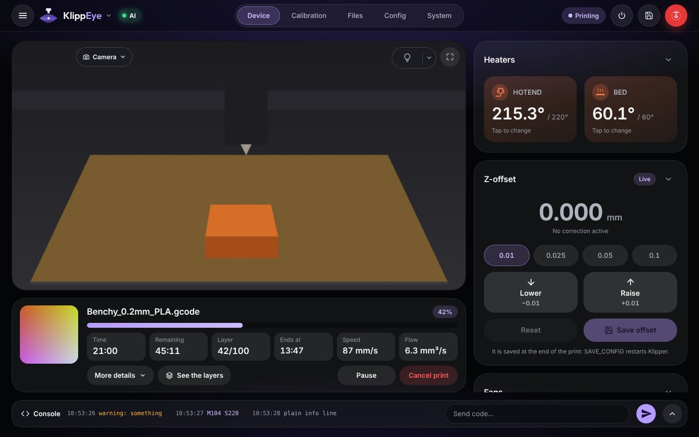
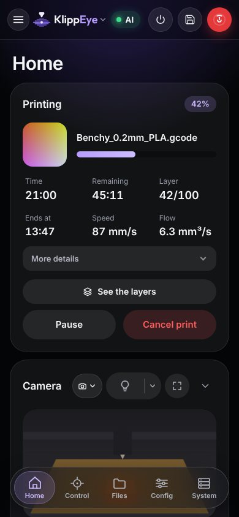

# KlippEye

**A dashboard for Klipper printers that also keeps an eye on your prints.**

KlippEye runs on the Raspberry Pi of your printer, next to Klipper and Moonraker. You open it in the browser of your phone
or computer, and from there you control the printer, watch the camera and get a notification on your phone when a print
finishes, fails or runs out of filament. While a print runs, an AI monitor looks at the camera and can pause the print
when it sees spaghetti, a part torn off the bed or a layer shift.

*Leggi in italiano: [docs/GUIDA.md](docs/GUIDA.md).*

<p align="center">
  
  &nbsp;
  
</p>
<p align="center"><sub>Screenshots with demo data.</sub></p>

## What it does

- **The whole printer at hand**: temperatures, fans, moves and Z-offset, files and print queue, console and macros,
  configuration editor, bed mesh, calibrations, history, timelapse, Spoolman. It works on a phone as well as on a big screen.
- **AI print monitor**: a small model runs on the Raspberry itself and works without internet. If you want, an online AI
  (Google Gemini, Groq and others have a free plan) double-checks the doubtful pictures. You decide whether it only warns
  you or also pauses the print.
- **Notifications on your phone**: print finished, error, pause, filament run out, AI alarms. They arrive through the
  KlippEye Android app or the free ntfy app (Android and iPhone), and you don't need to create an account or a key.
- **Android app**: the dashboard full screen, with notifications and updates that install themselves from the dashboard.
- **Home Assistant**: the printer shows up in Home Assistant by itself through MQTT.
- **Updates in one tap**, with a way back if an update goes wrong. After a power cut it repairs its own files.
- **In your language**: English, Italian, Spanish, German, French, Portuguese (Brazil), Polish, Russian, Ukrainian and
  Simplified Chinese.

## What you need

- A printer with **Klipper and Moonraker** on a Raspberry Pi (or another Linux computer next to the printer). If you
  already use another web interface for Klipper, keep it: KlippEye works alongside it.
- **SSH access** to the Raspberry, just once, to install.
- Optional: a **camera** (for the camera view and the AI monitor) and a **phone** (for notifications).

## Install

Connect to the Raspberry with SSH and paste these three lines:

```bash
sudo apt update && sudo apt install -y git
git clone https://github.com/BotuPotto/KlippEye.git ~/klippeye
bash ~/klippeye/scripts/install.sh
```

The installer adds whatever is missing, sets up the services and connects KlippEye to Moonraker's update manager. Then
open `http://<address of your Raspberry>` in a browser: a guided set-up takes you through the rest in a few minutes.

The [guide](docs/GUIDE.md) explains every step, with what to do if something does not go as expected.

## Documentation

| | |
|---|---|
| **[User guide](docs/GUIDE.md)** | install, first start, AI monitor, notifications, updates, problems and answers |
| **[The dashboard, page by page](docs/FEATURES.md)** | every card and every setting explained |
| **[Guida in italiano](docs/GUIDA.md)** · [Il pannello, pagina per pagina](docs/FUNZIONI.md) | the same, in Italian |
| [API for scripts and home automation](docs/API.md) | for those who want to talk to KlippEye from their own programs |
| [Android app](android/README.md) · [Local AI model](ml/README.md) | how they are built |
| [Contributing](CONTRIBUTING.md) · [Security](SECURITY.md) · [Changes](CHANGELOG.md) | |

Each page of the dashboard also has a **?** button with a short explanation of that page.

## Updating

**Settings → Updates → Update KlippEye.** Your settings stay as they are, and if a new version does not work as you hoped,
**Go back to the previous release** is on the same page. By default you get only the releases that passed all the
automatic tests; the [list of releases](https://github.com/BotuPotto/KlippEye/releases) says what each one changed.

## Getting help

Open an [issue](https://github.com/BotuPotto/KlippEye/issues) and attach the diagnostic report: **Settings → Updates →
Diagnostics → Download a diagnostic report** (or `klippeye diagnose --save` on the Raspberry). It contains no passwords,
keys or tokens. Security problems: please report them privately, as explained in [SECURITY.md](SECURITY.md).

## License

KlippEye is free software under the [GNU General Public License v3.0](LICENSE), like Klipper and Moonraker. Third-party
components and their licenses are listed in [THIRD_PARTY_NOTICES.md](THIRD_PARTY_NOTICES.md).
