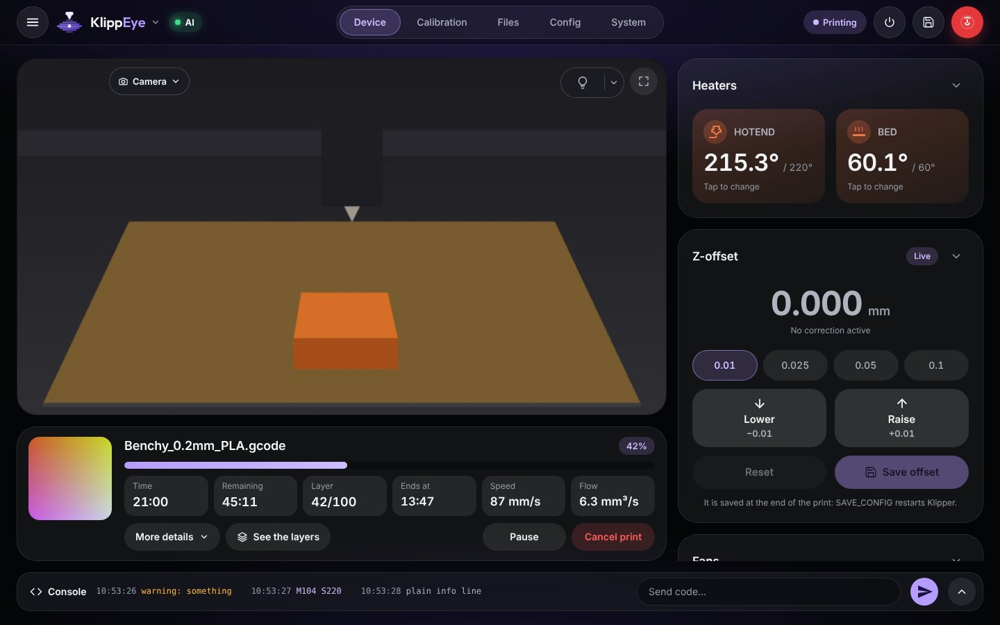
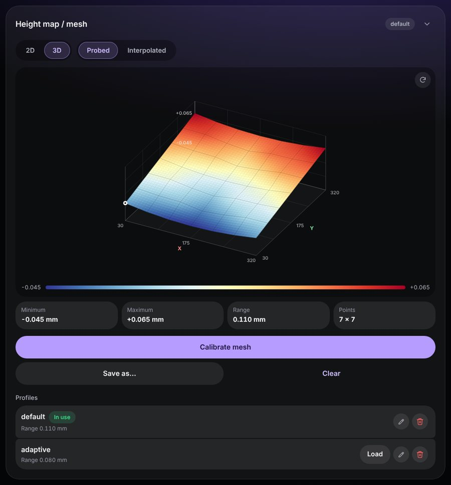
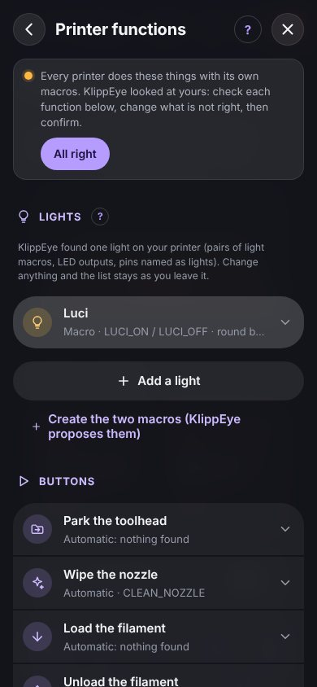

# The dashboard, page by page

This is the reference for what you see in the dashboard: every card, what its buttons do and the settings behind it. To
install KlippEye and set it up, start from the [user guide](GUIDE.md). *In italiano: [FUNZIONI.md](FUNZIONI.md).*

On a phone the pages are at the bottom of the screen: **Home**, **Control**, **Files**, **Config**,
**System**. On a computer the same cards are arranged on wider pages, with tabs at the top: **Device**, **Calibration**,
**Files**, **Config**, **System**. Below, each card says where to find it on both.

You can move, hide and fold the cards: see [Cards](#cards-and-the-order-of-the-pages).

**Contents**

- [The top bar](#the-top-bar)
- [Printing](#printing): the print card, before a print, excluding an object, the G-code viewer, how did the print go
- [Camera](#camera)
- [Temperatures, fans and devices](#temperatures-fans-and-devices)
- [Moving and calibrating](#moving-and-calibrating): moves, Z-offset, leveling, bed mesh, input shaper, endstops
- [Extruder, tune and spools](#extruder-tune-and-spools)
- [Macros and console](#macros-and-console)
- [Files](#files): print files, queue, scheduled prints, history, maintenance, timelapse
- [Configuration files and the editor](#configuration-files-and-the-editor)
- [System](#system)
- [Settings](#settings)

## The top bar

- **The printer's name** (with the arrow): with more than one printer, a tap lists them and switches between them.
- **AI**: the state of the AI monitor. Grey with no print, green when all is well, amber or red with an alarm. A tap opens
  the AI monitoring panel, with the last picture and the last verdict.
- **The state of the printer**: printing, paused, ready, error.
- **⏻ (power)**: restart Klipper (normal or firmware restart), restart, start or stop the services Moonraker manages
  (klipper, moonraker, crowsnest…), restart or shut down the Raspberry. It asks first while a print runs, and always before
  shutting down the Raspberry.
- **Save** (the disk): sends `SAVE_CONFIG`, which writes the pending changes (a new Z-offset, a bed mesh…) into
  `printer.cfg` and restarts Klipper. It asks first.
- **The red button**: emergency stop. Klipper stops at once and must be restarted.

When Klipper is not ready (starting, shut down, disconnected), a panel tells you what is happening and offers the right
button, with Klipper's own message when there was an error.

## Printing

### The print card

*Phone: Home. Computer: Device, under the camera.*

The file name with its thumbnail, the progress, the time printed, what is left, the layer, the clock time when it ends,
the speed and the volumetric flow right now. **More details** shows the estimates one by one (from the file, the
filament and the slicer), the total time with the pauses, the filament used, the height, and the speed and flow factors.

**Pause**, **Resume** and **Cancel print** are here. Cancel always asks first.

### Before a print starts

When you start a print, the confirmation window checks what could spoil it: Klipper not ready, an object taller than the
printer, a file sliced for another nozzle, temperatures above the printer's limits, layers too thick for the nozzle,
changes still waiting for `SAVE_CONFIG`. Nothing is blocked: you decide. When everything is fine, one line says so.

### Excluding an object

If the slicer labels the objects (PrusaSlicer, OrcaSlicer, SuperSlicer: *Label objects*; Cura with a plugin) and
`printer.cfg` has `[exclude_object]`, the print card offers **Exclude an object**. A map of the bed shows the objects (the
one being printed in blue): choose one and **Exclude it**. The others go on; the excluded one can't be put back in that
print.

### The G-code viewer

**See the layers** (in a file's menu, on the print card, *Layers* on the computer's file panel) draws the file from above,
one layer at a time. The slider, ‹ › or the arrow keys pick the layer. The lines are coloured by type (outer and inner walls,
top and bottom, infill, bridges, support, skirt and brim); tap a type in the legend to hide it. The layer below is grey, the
travel moves show on request. Pinch or the mouse wheel zooms, dragging moves.

While that file is printing, **Follow the print** shows the current layer, what is already printed and where the nozzle is.

### How did the print go?

At the end of a print a card at the top of Home asks how it went: *Went fine*, or *There was a problem* (which kind, and
from which picture it could be seen: the picture is shown big, with the slider and ‹ › under it, and a tap enlarges it
over the whole screen). It's optional: *Skip*, or *Don't ask again*. Your answers help the
AI monitor learn and measure itself ([guide, chapter 5](GUIDE.md#teaching-it-about-your-printer)).

### Windows opened by macros

Some macros ask you something in a window, with buttons (filament changes, Happy Hare, RatOS, Klippain and other macro
packs use Klipper's *prompt* actions). The window opens on every phone and computer, comes back if you reload the page, and
closes when the macro is done with it.

## Camera

*Phone: Home. Computer: Device, the big panel.*

- **The camera menu**: with more than one camera, choose which one to watch. The choice stays on this device.
- **The light button** switches the lights marked *Switched by the round button*; the arrow next to it opens all the
  lights, with brightness, colour and scenes (see [Lights](#lights)).
- **⛶ Full screen**. In the Android app the bars disappear and the screen turns to landscape. In a browser that can't turn
  the screen (an iPhone, for example) the picture itself is turned to fill a phone held sideways; ↻ switches that off. A tap
  shows the buttons; ⤡, Esc or the back button leave.

The camera settings are in [Settings → Camera](#camera-1).

## Temperatures, fans and devices

### Heaters and temperatures

*Phone: Home. Computer: Device.*

The heaters card shows the nozzle and the bed: tap one to set its temperature. The **Temperatures** card lists every
heater and sensor Klipper has (also `heater_generic`, `temperature_fan`, `temperature_sensor`; names starting with `_`
stay hidden) with temperature, target and power, and a chart of the last 5, 10 or 20 minutes. The target is dashed in
the same colour. A finger or the pointer on the chart reads the values at that moment. Tap a name to hide or show its
lines, tap a target to change it.

### Fans

*Phone: Home, in the heaters card. Computer: Device.* The part fan and the other fans Klipper controls, with their speed. A lock prevents changing the speed by mistake while
scrolling.

### Devices

*Phone: Control. Computer: Device, under the fans.* Shown only when there is something in it:

- Moonraker's `[power]` devices (smart plugs, relays): switching off asks first, because it may be the printer's own power;
- Klipper's `[output_pin]`s: a switch, or a slider for a PWM pin;
- the filament sensors, with their state and a switch to turn them on or off.

## Moving and calibrating

### Moving the printer

*Phone: Home. Computer: Device.*

The X/Y pad and the Z buttons move by 1 or 10 mm (50 and 100 mm can be added in *Settings → Motion*). **Home** homes all
the axes. Which way the Z arrows go depends on what Z moves: with a bed that moves, ↑ brings the bed up
towards the nozzle; with a toolhead that moves, ↑ lifts the toolhead. *Settings → Motion* reads it from Klipper or lets you
choose.

During a print the moves are replaced by the **Z-offset** (moving the toolhead during a print would ruin it).

### Z-offset

Lowers or raises the nozzle while printing (baby stepping), in steps of 0.01 to 0.1 mm. The new value counts until Klipper
restarts. To keep it, **Save offset** at the end of the print writes it into `printer.cfg` (with `SAVE_CONFIG`, which
restarts Klipper, so it is never offered during a print).

### Leveling

*The Calibrate button of the Movement card.* It offers what your printer has:

- **Z tilt adjust** (`[z_tilt]`) and **Quad gantry level** (`[quad_gantry_level]`);
- **Bed screws adjust** (`[bed_screws]`, for printers without a probe): the nozzle stops above each screw and a window tells
  you what to do with a sheet of paper. Answer *Adjusted* if you turned the screw, *Accept* if it was right already. Klipper
  goes round again until a whole round is accepted;
- **Axis twist compensation**: with a Cartographer probe its automatic calibration, otherwise Klipper's own, with the same
  paper test at a few points. Then `SAVE_CONFIG`.

### Bed mesh

*Phone: Control. Computer: Calibration.*

The height map of the bed, in 2D (seen from above, the back of the bed at the top, the value of each point; tap a point
to see where it is) or 3D (drag to turn, pinch or wheel to zoom, ↻ to go back). It shows the probed points or the
interpolated mesh Klipper uses, with minimum, maximum and range.

**Calibrate mesh** asks for a profile name (and *Adaptive*: only where the objects of the next print are). **Save as…**
keeps the mesh in use as a profile, **Clear** stops using it. Under Profiles: load, rename or remove the profiles in
`printer.cfg`. These changes are written by `SAVE_CONFIG` (the save button at the top).

### Input shaper

*Phone: Control. Computer: Calibration.* With an accelerometer, **Measure X** and **Measure Y** run Klipper's resonance test (`SHAPER_CALIBRATE`). The result is
drawn as a chart of the vibrations at each frequency, with what is left after the shaper Klipper recommends and the bands
that matter for your prints. A table compares the shapers (frequency, vibrations left, smoothing, highest acceleration).
**Save** writes the chosen shaper into the configuration and applies it at once.

### Endstops and probe

*Phone: Control. Computer: Calibration.* The state of each endstop and of the Z probe. They are read only when you press
**Refresh**, and not during a print.

## Extruder, tune and spools

### Extruder

*Phone: Control. Computer: Device.* Extrude and retract by hand, with the length and the speed you choose. The nozzle must
be hot.

### Tune

*Phone: Control. Computer: Device.* Changes things also during a print: the speed and flow factors, pressure
advance and its smooth time, the machine limits (velocity, acceleration, square corner velocity, minimum cruise
ratio) and the firmware retraction (when `[firmware_retraction]` exists). Under each value you see the one in
`printer.cfg`; the round arrow goes back to it. Nothing is written to `printer.cfg`: a restart of Klipper brings its
values back.

### Spools (Spoolman)

*Phone: Home. Computer: Device.* If Moonraker has `[spoolman]`, the **Spool** card shows the spool in use with its colour, maker, material and what is left.
**Change spool** lists the spools (the last used first, with a search): tap one and Moonraker counts each print's filament on
it. **No spool** leaves none selected.

### Multi-material units

With Happy Hare (MMU) or AFC (Box Turtle, Night Owl…), a card shows the gates or lanes with their colour, material and state,
what is loaded and what the unit is doing, and the everyday commands: change tool, select a gate, load, unload, home,
recover.

## Macros and console

### Macros

*Phone: Control. Computer: Calibration.*

Your macros as buttons. **Settings → Macros** (or the gear of the card) chooses how:

- **All the macros** in one card; switch off the ones you never use. Macros whose name starts with `_` are never shown;
- **Groups**: cards of your own, each with a name, a colour, the macros you pick in your order, and when it shows (idle,
  printing, paused). For example the filament macros also while paused, the calibrations only when idle.

A macro with parameters has a ⚙ next to its name: it opens a form with the values to send. The choice is the same on every
device.

### Console

*Phone: Control. Computer: the bar at the bottom (its arrow opens the whole log).*

Type G-code or macro names; a tap on an earlier command puts it back in the field. In the title: clear (empties the
view), the options (*Autoscroll*, *Newest on top*, *Show temperatures*, kept on this device) and full screen.

## Files

### Print files

The G-code files on the printer, with search (also by folder) and order (newest, oldest, name, print time, filament,
size, last printed). A long press on a file opens its menu:

- **Details**: folder, size, dates, slicer, estimated time, layer heights, object height, filament (type, length, weight),
  nozzle, first-layer temperatures, with *Start print*;
- **See the layers** (the [G-code viewer](#the-g-code-viewer)), **Add to the queue**, **Schedule the print**, **Open in
  the editor**, **Delete**.

On a computer the panel next to the list has the same buttons. Files reach the printer from your slicer, as usual.

### Print queue

If `moonraker.conf` has `[job_queue]`, a file's menu offers **Add to the queue**, with the number of copies: the prints start
one after the other. While jobs wait, the **Print queue** card at the top of Files shows them in order with their times:
move them, remove them, **Start the queue**, **Pause the queue**, **Empty**.

### Scheduled prints

**Schedule the print** (in a file's menu) starts a print by itself on the day and at the time you choose. The Raspberry
keeps the list, so nothing needs to stay open. If at that time the printer is busy or Klipper is not ready, the print is
not started later on its own (the bed might not be clear): the card says it was missed and why.

### History

At the top of Files, a switch goes from *Print files* to **History**. The statistics: number of prints, print time,
filament used, longest and average print, how they ended, and a chart of the last 14 days. Below, the list of prints
with search and filters. Tap a print for its details, a note (every device sees it), **Print again** or **Remove**.
*Reset* sets Moonraker's totals back to zero. Without `[history]` in `moonraker.conf`, the page tells you to add it.

### Maintenance

Under History, reminders such as "grease the rails every 200 printing hours" or "change the nozzle every 2 km of
filament". Each counts printing hours, metres of filament or days since the last time you did it. When one is due, a message
says so once a day; **Done** starts it again.

### Timelapse

With moonraker-timelapse installed, Files has a **Timelapse** part:

- the videos (tap one to watch it full screen, *Download*, delete);
- the frames of the last print that are not a video yet, with **Make the video**;
- the settings (also in *Settings → Camera → Timelapse*): on or off, which camera, a frame every layer or at intervals,
  parking the toolhead for the frame and where, making the video at the end, frames per second or video length, quality,
  and under **Advanced** all the others.

**Save and restart Moonraker** writes the changes in the `[timelapse]` section of `moonraker.conf` (only those that differ
from the defaults; the rest of the file stays as it is) and restarts Moonraker. It can't be done during a print. If
`printer.cfg` lacks `[include timelapse.cfg]`, the page says so. Without moonraker-timelapse, the page explains how to
install it.

## Configuration files and the editor

### Configuration files

*Phone and computer: Config.* Folders first, then files. The ⇅ button chooses the order (name, last change, size) and
whether to show the backups (the `printer-YYYYMMDD_HHMMSS.cfg` written by `SAVE_CONFIG`, `.bak`, `.bkp`…) and the
hidden files. A line under the list says how many are left out; tap it to show them.

**New** creates an empty file or folder, or uploads files from this device (several at once). A file's menu opens it in the
editor, downloads, renames, moves or deletes it. For the files Klipper and Moonraker read at startup (`printer.cfg`,
`moonraker.conf`), KlippEye warns you before a move, a new name or a deletion that would stop the printer from starting.

### The editor

Configuration and G-code files open in the dashboard's editor (CodeMirror 6): line numbers, colours for sections, keys,
pins, values, comments, G-code and the Jinja2 of macros.

- The arrow next to a `[section]` folds it; **Sections of the file** lists them all (tap one to go there).
- The page button opens the reference for the section the cursor is in: Klipper's Config Reference for `.cfg` files,
  Moonraker's configuration page for `moonraker.conf`.
- **Find and replace** (the magnifier or Ctrl+F), **Undo / Redo** (Ctrl+Z / Ctrl+Y), **Comment / Uncomment** (Ctrl+/),
  **Save** (Ctrl+S) and **Save and restart**.
- **Versions**: before the editor writes a configuration file, KlippEye keeps the text it had (the last 30). For
  `printer.cfg` also Klipper's own backups. The list shows what is different from the text in the editor and puts an
  earlier version back in the editor. Nothing is written until you press Save.

## System

*Phone and computer: System.*

- **The Raspberry**: processor load and memory.
- **Firmware**: the versions of the boards (MCU).
- **Updates of the printer's programs**: Klipper, Moonraker and the others Moonraker manages, with a confirmation, the
  progress and the way back. KlippEye's own update is in *Settings → Updates*.
- **Logs**: the logs of Klipper, Moonraker and crowsnest. Read one in the editor, download it, or have the AI analyse it
  (**Error analysis and suggestions**, with its own AI service and model: the gear next to it).
- **Devices connected to the Raspberry**: serial ports (the address to write under `[mcu]` in `printer.cfg`), USB devices,
  cameras and the boards waiting on a CAN network (their `canbus_uuid`). Tap an address to copy it.

## Settings

**☰** at the top left. The search box at the top finds any page, also those inside another. Each page has a **?** with a
short explanation.

### Your printers

The other printers with KlippEye on your network. Write the address of another one (the port 8085 is added by itself):
*Try* checks that it answers, *Add* puts it in the list. Then a tap on the name in the top bar switches from one to the
other, and the **Overview** shows them all together. The list is the same on every device of this printer.

### Printer functions

Every printer parks, wipes the nozzle, loads filament or switches its light with its own macros, or can't. This page says
what each button of the dashboard does. KlippEye fills it in by itself the first time, looking for the usual names
(`PARK`, `CLEAN_NOZZLE`, `LOAD_FILAMENT`, `M701`, `UNLOAD_FILAMENT`, `M702`, a pair like `LIGHTS_ON` / `LIGHTS_OFF`). Check
it once and press **All right**. For each function:

- **Automatic**: what KlippEye found (or that it found nothing, and the button is hidden);
- **Macro**: one of your macros;
- **G-code**: a few lines you write in the editor;
- **Not used**: the button is hidden;
- **Create a macro for this**: KlippEye proposes one (park at the back, heat and load, heat and unload, wipe on a brush
  whose position you set). It opens in the editor, and when you save it goes into `klippeye_macros.cfg`, KlippEye's own file
  next to `printer.cfg`. The first time, `printer.cfg` gets `[include klippeye_macros.cfg]` at the end, with a backup.
  Klipper reads the new macro after a restart: the page offers **Restart Klipper now** (not during a print).

#### Lights

KlippEye finds the lights by itself: pairs of light macros, LED outputs (`[led]`, `[neopixel]`, `[dotstar]`…) and pins
whose name says *light*. Under **Lights** you can rename one, change how it is switched (an output, two macros, G-code) and
where its state is read, remove it or add more. *Find the lights again* goes back to what KlippEye finds.

The button always shows the real state of the light, also when it was switched from somewhere else (a screen on the printer,
the console, a macro). The lights marked *Switched by the round button* go on and off together from the camera. The arrow
next to it opens every light, with brightness, colour, and scenes: *Save as a scene* keeps how the lights are now under
a name, and one tap brings it back.

#### Filament change

The phone gets *Filament run out* when:

- a filament sensor says the filament is gone during a print;
- one of the macros you choose runs (`M600`, your runout macro…). KlippEye adds to `klippeye_macros.cfg` a small
  wrapper with the same name that writes a line in the console and then runs your macro exactly as before;
- a line of the console you choose appears (*Printer paused due to filament runout!* is always recognised).

### Macros

How the macro cards show: see [Macros](#macros).

### Motion and Z-offset

What Z moves (the bed or the toolhead), the steps of the moves (50 and 100 mm can be added) and those of the Z-offset card.

### Materials

The materials offered in the temperature window: a tap sets nozzle and bed together. They are yours to change, add and
remove. With Spoolman, the spool in use is offered first, with the temperatures of its filament.

### Camera

The way the camera is shown (WebRTC, MJPEG, adaptive MJPEG, or any web page) and its address. **Import from the printer**
takes the cameras Moonraker knows. The snapshot (single photo) is what the AI monitor uses: *Try: take a photo* shows it
as the Raspberry gets it. Each camera of the printer has its own page, with its flips. **Timelapse** is here too.

### AI monitor

Everything about the AI monitor, from top to bottom: on or off; how it looks at the print (with the links to *Camera
calibration*, *Monitor thresholds* and *Recordings*); when it sees a problem (minimum confidence, defects, checks in a
row, automatic pause and cancel); the AI service (who judges the pictures: online AI and local model, or the local model
only; the service, the model, the keys, the backup services); the local model (its switches and learning from your
prints). The [guide](GUIDE.md#5-the-ai-monitor) explains how to set it up.

**Monitor thresholds** holds the fine numbers: sensitivity, how long a change must stay, light changes, pauses between
analyses, when checking starts, the local model's thresholds, and the rectangle watched without a calibration.

### Notifications

Where they arrive (this phone with the app, other phones with ntfy), which ones, in which language, their texts and your own
extra notifications. See the [guide, chapter 6](GUIDE.md#6-notifications-on-your-phone).

### Appearance

- **Logo and name** of the printer, in the top bar and in the browser tab.
- **Theme**: Dark, Light, or *As the device*, which follows the phone or computer, also when it changes by itself in the
  evening. The code editor and the camera stay dark.
- **Colour** of buttons, switches and highlights: the logo's violet, blue, teal, green, amber, pink, or any colour from
  the wheel (one too dark or too pale is adjusted so that it reads well).
- **Look**: the same page dressed after another popular app: One UI (the usual), Liquid Glass, Material 3 Expressive,
  HyperOS 4, Studio, Soft, Fluent or Aurora.
- **Show the hints**: hides the small texts that explain how to use a page (*Tap to change* and the like).

Colour, look, theme and hints belong to the device you are on.

#### Cards and the order of the pages

The main cards have a chevron at the top right that folds them to their title (it stays so on this device). In
*Appearance → Cards* a small drawing of each page lets you drag a card by its handle (or move it with the arrows), also
into the other column, and show or hide it with its switch. Phone, tablet and computer each keep their own layout. The print
card stays in its place. *Usual order, everything shown* goes back to the start.

### Language

English, Italian, Spanish, German, French, Portuguese (Brazil), Polish, Russian, Ukrainian or Simplified Chinese, chosen on
each device. *Automatic* follows the device's language.

### Addresses

Only for using KlippEye away from home with a VPN: the Raspberry's address on your home network and on the VPN. With the
**ZeroTier guide**, six steps with the commands to copy. See the [guide, chapter 8](GUIDE.md#8-using-it-away-from-home).

### Access

The optional password and the guest password. See the [guide, chapter 10](GUIDE.md#10-password-and-security).

### Home Assistant / MQTT

The printer in Home Assistant or another smart-home system. See the [guide, chapter 11](GUIDE.md#11-home-assistant-and-mqtt).

### Updates

The installed release and the new ones, the update channel, going back to the previous release, restoring the program
files, restarting the services, the Android app, the diagnostic report, and the automatic check for new versions. See the
[guide, chapter 9](GUIDE.md#9-updates).

### Guided set-up

Runs the [guided set-up](GUIDE.md#3-first-start) again.
