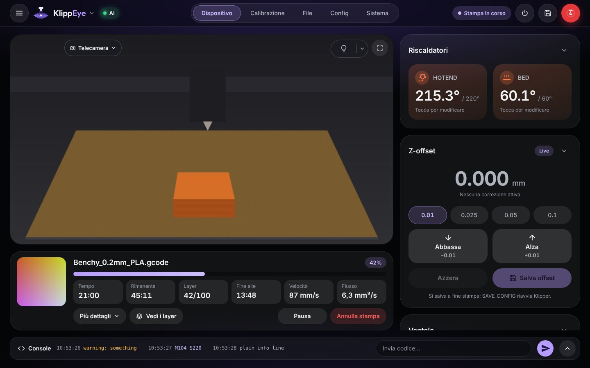
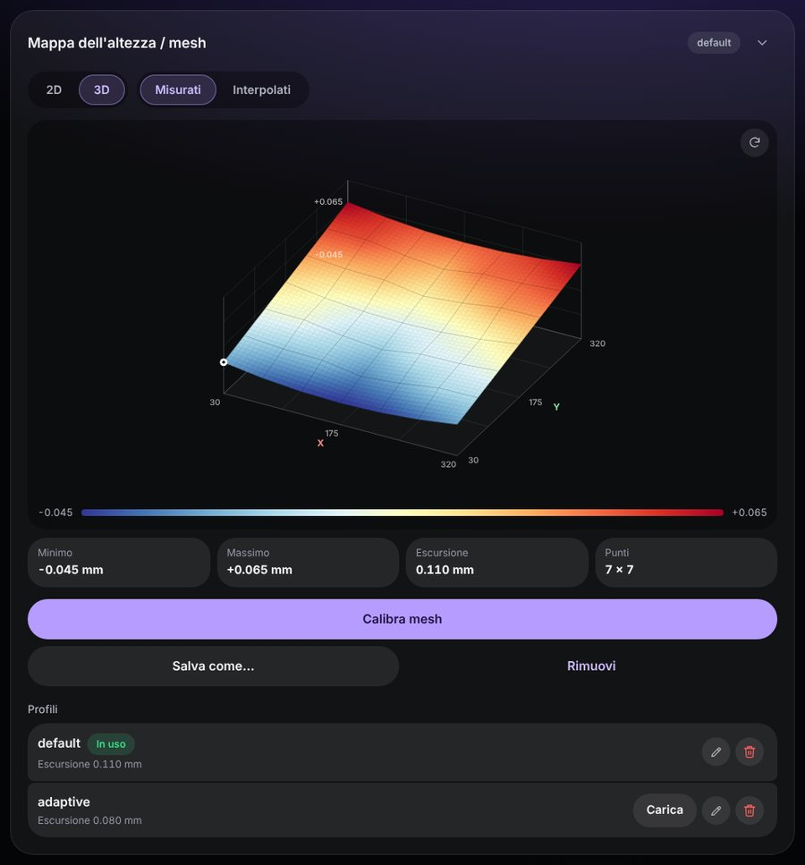

# Il pannello, pagina per pagina

Questo è il riferimento di quello che vedi nella dashboard: ogni card, cosa fanno i suoi pulsanti e le impostazioni che ci
stanno dietro. Per installare KlippEye e configurarla, parti dalla [guida](GUIDA.md). *In English: [FEATURES.md](FEATURES.md).*

Sul telefono le pagine sono in basso: **Home**, **Controllo**, **File**, **Config**, **Sistema**. Sul computer le stesse card
stanno su pagine più larghe, con le schede in alto: **Dispositivo**, **Calibrazione**, **File**, **Config**, **Sistema**. Qui
sotto, per ogni card c'è scritto dove trovarla nei due casi.

Le card si possono spostare, nascondere e chiudere: vedi [Card](#card-e-ordine-delle-pagine).

**Indice**

- [La barra in alto](#la-barra-in-alto)
- [Stampare](#stampare): la card della stampa, prima di stampare, escludere un oggetto, il visualizzatore del G-code, com'è andata
- [Telecamera](#telecamera)
- [Temperature, ventole e dispositivi](#temperature-ventole-e-dispositivi)
- [Muovere e calibrare](#muovere-e-calibrare): movimenti, Z-offset, livellamento, mesh del piatto, input shaper, finecorsa
- [Estrusore, regolazioni e bobine](#estrusore-regolazioni-e-bobine)
- [Macro e console](#macro-e-console)
- [File](#file): file di stampa, coda, stampe programmate, cronologia, manutenzione, timelapse
- [File di configurazione ed editor](#file-di-configurazione-ed-editor)
- [Sistema](#sistema)
- [Impostazioni](#impostazioni)

## La barra in alto

- **Il nome della stampante** (con la freccia): con più stampanti, un tocco le elenca e passa dall'una all'altra.
- **IA**: lo stato del monitor IA. Grigio senza stampa, verde se è tutto a posto, arancione o rosso con un allarme. Un tocco
  apre il pannello del monitoraggio IA: i punteggi del modello locale e di OpenCV (l'ultimo e il massimo della stampa),
  l'ultima foto e l'ultimo giudizio.
- **Lo stato della stampante**: in stampa, in pausa, pronta, errore.
- **⏻ (accensione)**: riavvia Klipper (normale o riavvio del firmware), riavvia, avvia o ferma i servizi gestiti da Moonraker
  (klipper, moonraker, crowsnest…), riavvia o spegne il Raspberry. Chiede conferma durante una stampa, e sempre prima di
  spegnere il Raspberry.
- **Salva** (il dischetto): manda `SAVE_CONFIG`, che scrive in `printer.cfg` le modifiche in sospeso (un nuovo Z-offset, una
  mesh…) e riavvia Klipper. Chiede conferma.
- **Il pulsante rosso**: arresto di emergenza. Klipper si ferma subito e va riavviato.

Quando Klipper non è pronto (si sta avviando, è spento, è scollegato), un pannello ti dice cosa succede e ti offre il
pulsante giusto, con il messaggio di Klipper se c'è stato un errore.

## Stampare

### La card della stampa

*Telefono: Home. Computer: Dispositivo, sotto la telecamera.*

Il nome del file con la sua anteprima, l'avanzamento, il tempo di stampa, quanto manca, il layer, l'ora in cui finisce, la
velocità e il flusso volumetrico del momento. **Più dettagli** mostra le stime una per una (dal file, dal filamento e dallo
slicer), il tempo totale con le pause, il filamento usato, l'altezza, e i fattori di velocità e flusso.

Qui ci sono **Pausa**, **Riprendi** e **Annulla stampa**. L'annullamento chiede sempre conferma.

### Prima che parta una stampa

Quando avvii una stampa, la finestra di conferma controlla cosa potrebbe rovinarla: Klipper non pronto, un oggetto più alto
della stampante, un file preparato per un altro ugello, temperature oltre i limiti della stampante, layer troppo spessi per
l'ugello, modifiche che aspettano ancora `SAVE_CONFIG`. Non blocca niente: decidi tu. Se è tutto a posto, lo dice una riga.

### Escludere un oggetto

Se lo slicer dà un nome agli oggetti (PrusaSlicer, OrcaSlicer, SuperSlicer: *Label objects*; Cura con un plugin) e
`printer.cfg` ha `[exclude_object]`, la card della stampa offre **Escludi un oggetto**. Una mappa del piatto mostra gli
oggetti (quello in stampa in blu): scegline uno e **Escludilo**. Gli altri vanno avanti; quello escluso non si può rimettere
in quella stampa.

### Il visualizzatore del G-code

**Vedi i layer** (nel menu di un file, nella card della stampa, *Layer* nel pannello dei file sul computer) disegna il file
visto dall'alto, un layer alla volta. Il cursore, ‹ › o le frecce della tastiera scelgono il layer. Le linee hanno il colore
del loro tipo (pareti esterne e interne, superfici sopra e sotto, riempimento, ponti, supporti, skirt e brim); tocca un tipo
nella legenda per nasconderlo. Il layer sotto è grigio, gli spostamenti a vuoto si vedono a richiesta. Pizzica o usa la
rotellina per lo zoom, trascina per spostarti.

Mentre quel file è in stampa, **Segui la stampa** mostra il layer corrente, cosa è già stampato e dove sta l'ugello.

### Com'è andata la stampa?

A fine stampa una card in cima alla Home chiede com'è andata: *Andata bene*, oppure *C'era un problema* (di che tipo e da
quale foto si vedeva: la foto è grande, con il cursore e ‹ › subito sotto, e un tocco la ingrandisce a tutto schermo). È facoltativa: *Salta*, oppure *Non chiedere più*. Le tue risposte aiutano il monitor IA
a imparare e a misurarsi ([guida, capitolo 5](GUIDA.md#insegnargli-comè-la-tua-stampante)).

### Finestre aperte dalle macro

Alcune macro ti chiedono qualcosa in una finestra con dei pulsanti (cambi filamento, Happy Hare, RatOS, Klippain e altri
pacchetti di macro usano le azioni *prompt* di Klipper). La finestra si apre su ogni telefono e computer, torna se ricarichi
la pagina e si chiude quando la macro ha finito.

## Telecamera

*Telefono: Home. Computer: Dispositivo, il riquadro grande.*

- **Il menu della telecamera**: con più telecamere scegli quale guardare. La scelta resta su questo dispositivo.
- **Il pulsante della luce** accende e spegne le luci segnate *Comandata dal pulsante tondo*; la freccia accanto apre tutte
  le luci, con luminosità, colore e scene (vedi [Luci](#luci)).
- **⛶ Schermo intero**. Nell'app Android spariscono le barre e lo schermo gira in orizzontale. In un browser che non può
  girare lo schermo (un iPhone, per esempio) gira l'immagine stessa, per riempire un telefono tenuto di traverso; ↻ lo
  disattiva. Un tocco mostra i pulsanti; ⤡, Esc o il tasto indietro escono.

Le impostazioni della telecamera sono in [Impostazioni → Telecamera](#telecamera-1).

## Temperature, ventole e dispositivi

### Riscaldatori e temperature

*Telefono: Home. Computer: Dispositivo.*

La card dei riscaldatori mostra ugello e piatto: toccane uno per impostarne la temperatura. La card **Temperature** elenca
ogni riscaldatore e sensore che Klipper conosce (anche `heater_generic`, `temperature_fan`, `temperature_sensor`; i nomi che
cominciano con `_` restano nascosti) con temperatura, obiettivo e potenza, e un grafico degli ultimi 5, 10 o 20 minuti.
L'obiettivo è tratteggiato nello stesso colore. Un dito o il puntatore sul grafico leggono i valori di quel momento. Tocca un
nome per nascondere o mostrare le sue linee, tocca un obiettivo per cambiarlo.

### Ventole

*Telefono: Home, nella card dei riscaldatori. Computer: Dispositivo.* La ventola del pezzo e le altre ventole comandate da
Klipper, con la loro velocità. Un blocco evita di cambiare la velocità per sbaglio mentre scorri la pagina.

### Dispositivi

*Telefono: Controllo. Computer: Dispositivo, sotto le ventole.* Compare solo quando c'è qualcosa:

- i dispositivi `[power]` di Moonraker (prese smart, relè): spegnerli chiede conferma, perché potrebbe essere l'alimentazione
  della stampante;
- gli `[output_pin]` di Klipper: un interruttore, o un cursore per un pin PWM;
- i sensori del filamento, con il loro stato e un interruttore per accenderli o spegnerli.

## Muovere e calibrare

### Muovere la stampante

*Telefono: Home. Computer: Dispositivo.*

La croce X/Y e i pulsanti Z muovono di 1 o 10 mm (50 e 100 mm si aggiungono in *Impostazioni → Movimento*). **Home** fa
l'homing di tutti gli assi. Il verso delle frecce Z dipende da cosa muove Z: con il piatto che si muove, ↑ alza il piatto
verso l'ugello; con la testina che si muove, ↑ alza la testina. *Impostazioni → Movimento* lo legge da Klipper o te lo fa
scegliere.

Durante una stampa al posto dei movimenti c'è lo **Z-offset** (muovere la testina durante una stampa la rovinerebbe).

### Z-offset

Abbassa o alza l'ugello mentre stampa (baby stepping), a passi da 0,01 a 0,1 mm. Il nuovo valore vale finché Klipper non si
riavvia. Per tenerlo, a fine stampa **Salva offset** lo scrive in `printer.cfg` (con `SAVE_CONFIG`, che riavvia Klipper, per
questo non viene mai offerto durante una stampa).

### Livellamento

*Il pulsante Calibra della card Movimento.* Offre quello che ha la tua stampante:

- **Z tilt adjust** (`[z_tilt]`) e **Quad gantry level** (`[quad_gantry_level]`);
- **Bed screws adjust** (`[bed_screws]`, per le stampanti senza sonda): l'ugello si ferma sopra ogni vite e una finestra ti
  dice cosa fare con un foglio di carta. Rispondi *Regolata* se hai girato la vite, *Accetta* se andava già bene. Klipper fa
  un altro giro finché un giro intero non viene accettato;
- **Axis twist compensation**: con una sonda Cartographer la sua calibrazione automatica, altrimenti quella di Klipper, con
  la stessa prova del foglio in qualche punto. Poi `SAVE_CONFIG`.

### Mesh del piatto

*Telefono: Controllo. Computer: Calibrazione.*

La mappa dell'altezza del piatto, in 2D (vista dall'alto, il fondo del piatto in alto, il valore di ogni punto; tocca un
punto per vedere dov'è) o in 3D (trascina per girarla, pizzica o usa la rotellina per lo zoom, ↻ per tornare). Mostra i punti
misurati o la mesh interpolata che usa Klipper, con minimo, massimo e differenza.

**Calibra mesh** chiede il nome del profilo (e *Adattiva*: solo dove stanno gli oggetti della prossima stampa).
**Salva come…** tiene come profilo la mesh in uso, **Rimuovi** smette di usarla. In Profili: carica, rinomina o elimina i
profili di `printer.cfg`. Queste modifiche le scrive `SAVE_CONFIG` (il pulsante salva in alto).

### Input shaper

*Telefono: Controllo. Computer: Calibrazione.* Con un accelerometro, **Misura X** e **Misura Y** lanciano il test delle
risonanze di Klipper (`SHAPER_CALIBRATE`). Il risultato è un grafico delle vibrazioni a ogni frequenza, con quello che resta
dopo lo shaper consigliato da Klipper e le fasce che contano per le tue stampe. Una tabella confronta gli shaper (frequenza,
vibrazioni rimaste, smussatura, accelerazione massima). **Salva** scrive lo shaper scelto nella configurazione e lo applica
subito.

### Finecorsa e sonda

*Telefono: Controllo. Computer: Calibrazione.* Lo stato di ogni finecorsa e della sonda Z. Si leggono solo quando premi
**Aggiorna**, e non durante una stampa.

## Estrusore, regolazioni e bobine

### Estrusore

*Telefono: Controllo. Computer: Dispositivo.* Estrudi e ritrai a mano, con la lunghezza e la velocità che scegli. L'ugello
deve essere caldo.

### Regolazioni

*Telefono: Controllo. Computer: Dispositivo.* Cambia alcune cose anche durante una stampa: i fattori di velocità e di
flusso, il pressure advance e il suo smooth time, i limiti della macchina (velocità, accelerazione, velocità negli angoli,
minimum cruise ratio) e la retrazione del firmware (quando c'è `[firmware_retraction]`). Sotto ogni valore vedi quello di
`printer.cfg`; la freccia tonda lo rimette. Non si scrive niente in `printer.cfg`: un riavvio di Klipper riporta i suoi
valori.

### Bobine (Spoolman)

*Telefono: Home. Computer: Dispositivo.* Se Moonraker ha `[spoolman]`, la card **Bobina** mostra la bobina in uso con il suo
colore, il produttore, il materiale e quanto ne resta. **Cambia bobina** elenca le bobine (le ultime usate per prime, con una
ricerca): toccane una e Moonraker conta su di essa il filamento di ogni stampa. **Nessuna bobina** non ne seleziona nessuna.

### Unità multimateriale

Con Happy Hare (MMU) o AFC (Box Turtle, Night Owl…), una card mostra gli ingressi con colore, materiale e stato, cosa è
caricato e cosa sta facendo l'unità, e i comandi di tutti i giorni: cambio utensile, scelta dell'ingresso, carica, scarica,
homing, recupero.

## Macro e console

### Macro

*Telefono: Controllo. Computer: Calibrazione.*

Le tue macro come pulsanti. **Impostazioni → Macro** (o l'ingranaggio della card) sceglie come:

- **Tutte le macro** in una card; spegni quelle che non usi mai. Le macro che cominciano con `_` non si vedono mai;
- **Gruppi**: card tue, ognuna con un nome, un colore, le macro che scegli nell'ordine che vuoi, e quando si vede (ferma, in
  stampa, in pausa). Per esempio le macro del filamento anche in pausa, le calibrazioni solo da ferma.

Una macro con parametri ha un ⚙ accanto al nome: apre un modulo con i valori da mandare. La scelta è la stessa su ogni
dispositivo.

### Console

*Telefono: Controllo. Computer: la barra in basso (la sua freccia apre tutto il log).*

Scrivi G-code o nomi di macro; un tocco su un comando precedente lo rimette nel campo. Nel titolo: cancella (svuota la
vista), le opzioni (*Scorrimento automatico*, *Più recenti in alto*, *Mostra le temperature*, tenute su questo dispositivo) e
lo schermo intero.

## File

### File di stampa

I file G-code sulla stampante, con ricerca (anche per cartella) e ordine (più recenti, più vecchi, nome, tempo di stampa,
filamento, dimensione, ultima stampa). Una pressione lunga su un file apre il suo menu:

- **Dettagli**: cartella, dimensione, date, slicer, tempo stimato, altezze dei layer, altezza dell'oggetto, filamento (tipo,
  lunghezza, peso), ugello, temperature del primo layer, con *Avvia stampa*;
- **Vedi i layer** (il [visualizzatore del G-code](#il-visualizzatore-del-g-code)), **Aggiungi alla coda**, **Programma la
  stampa**, **Apri nell'editor**, **Elimina**.

Sul computer il pannello accanto all'elenco ha gli stessi pulsanti. I file arrivano alla stampante dal tuo slicer, come
sempre.

### Coda di stampa

Se `moonraker.conf` ha `[job_queue]`, il menu di un file offre **Aggiungi alla coda**, con il numero di copie: le stampe
partono una dopo l'altra. Mentre ci sono lavori in attesa, la card **Coda di stampa** in cima a File li mostra in ordine con i
loro tempi: spostali, toglili, **Avvia la coda**, **Metti in pausa la coda**, **Svuota**.

### Stampe programmate

**Programma la stampa** (nel menu di un file) fa partire una stampa da sola nel giorno e all'ora che scegli. L'elenco lo tiene
il Raspberry, quindi non serve lasciare aperto niente. Se a quell'ora la stampante è occupata o Klipper non è pronto, la
stampa non parte più tardi da sola (il piatto potrebbe non essere libero): la card dice che è saltata e perché.

### Cronologia

In cima a File un selettore passa da *File di stampa* a **Cronologia**. Le statistiche: numero di stampe, tempo di stampa,
filamento usato, stampa più lunga e media, come sono finite, e un grafico degli ultimi 14 giorni. Sotto, l'elenco delle
stampe con ricerca e filtri. Tocca una stampa per i dettagli, una nota (la vedono tutti i dispositivi), **Stampa di nuovo** o
**Rimuovi**. *Azzera* rimette a zero i totali di Moonraker. Senza `[history]` in `moonraker.conf`, la pagina ti dice di
aggiungerlo.

### Manutenzione

Sotto la cronologia, promemoria come «ingrassa le guide ogni 200 ore di stampa» o «cambia l'ugello ogni 2 km di
filamento». Ognuno conta ore di stampa, metri di filamento o giorni dall'ultima volta che l'hai fatto. Quando uno scade, un
messaggio lo dice una volta al giorno; **Fatto** lo fa ripartire.

### Timelapse

Con moonraker-timelapse installato, File ha una parte **Timelapse**:

- i video (toccane uno per guardarlo a schermo intero, *Scarica*, elimina);
- le foto dell'ultima stampa non ancora diventate un video, con **Crea il video**;
- le impostazioni (anche in *Impostazioni → Telecamera → Timelapse*): acceso o spento, quale telecamera, una foto a ogni
  layer o a intervalli, parcheggio della testina per la foto e dove, video alla fine, foto al secondo o durata del video,
  qualità, e in **Avanzate** tutte le altre.

**Salva e riavvia Moonraker** scrive le modifiche nella sezione `[timelapse]` di `moonraker.conf` (solo quelle diverse dai
valori predefiniti; il resto del file resta com'è) e riavvia Moonraker. Non si può fare durante una stampa. Se `printer.cfg`
non ha `[include timelapse.cfg]`, la pagina lo dice. Senza moonraker-timelapse, la pagina spiega come installarlo.

## File di configurazione ed editor

### File di configurazione

*Telefono e computer: Config.* Prima le cartelle, poi i file. Il pulsante ⇅ sceglie l'ordine (nome, ultima modifica,
dimensione) e se mostrare le copie di sicurezza (i `printer-AAAAMMGG_HHMMSS.cfg` scritti da `SAVE_CONFIG`, `.bak`, `.bkp`…) e
i file nascosti. Una riga sotto l'elenco dice quanti ne restano fuori; toccala per vederli.

**Nuovo** crea un file o una cartella vuoti, oppure carica file da questo dispositivo (anche più insieme). Il menu di un file
lo apre nell'editor, lo scarica, lo rinomina, lo sposta o lo elimina. Per i file che Klipper e Moonraker leggono all'avvio
(`printer.cfg`, `moonraker.conf`), KlippEye ti avvisa prima di uno spostamento, di un nome nuovo o di un'eliminazione che
impedirebbe alla stampante di partire.

### L'editor

I file di configurazione e di G-code si aprono nell'editor della dashboard (CodeMirror 6): numeri di riga, colori per
sezioni, chiavi, pin, valori, commenti, G-code e il Jinja2 delle macro.

- La freccia accanto a una `[sezione]` la chiude; **Sezioni del file** le elenca tutte (toccane una per andarci).
- Il pulsante con la pagina apre il riferimento della sezione in cui sta il cursore: il Config Reference di Klipper per i
  file `.cfg`, la pagina di configurazione di Moonraker per `moonraker.conf`.
- **Trova e sostituisci** (la lente o Ctrl+F), **Annulla / Ripeti** (Ctrl+Z / Ctrl+Y), **Commenta / Decommenta**
  (Ctrl+/), **Salva** (Ctrl+S) e **Salva e riavvia**.
- **Versioni**: prima che l'editor scriva un file di configurazione, KlippEye tiene il testo che aveva (le ultime 30). Per
  `printer.cfg` anche le copie di sicurezza di Klipper. L'elenco mostra cosa cambia rispetto al testo nell'editor e rimette
  nell'editor una versione precedente. Non si scrive niente finché non premi Salva.

## Sistema

*Telefono e computer: Sistema.*

- **Il Raspberry**: carico del processore e memoria.
- **Firmware**: le versioni delle schede (MCU).
- **Aggiornamenti dei programmi della stampante**: Klipper, Moonraker e gli altri gestiti da Moonraker, con conferma,
  avanzamento e la possibilità di tornare indietro. L'aggiornamento di KlippEye è in *Impostazioni → Aggiornamenti*.
- **Log**: i log di Klipper, Moonraker e crowsnest. Leggine uno nell'editor, scaricalo, o fallo analizzare all'IA (**Analisi
  errori e suggerimenti**, con un suo servizio e modello di IA: l'ingranaggio accanto).
- **Dispositivi collegati al Raspberry**: porte seriali (l'indirizzo da scrivere sotto `[mcu]` in `printer.cfg`), dispositivi
  USB, telecamere e le schede in attesa su una rete CAN (il loro `canbus_uuid`). Tocca un indirizzo per copiarlo.

## Impostazioni

**☰** in alto a sinistra. La ricerca in cima trova qualsiasi pagina, anche quelle dentro un'altra. Ogni pagina ha un **?** con
una breve spiegazione.

### Le tue stampanti

Le altre stampanti con KlippEye nella tua rete. Scrivi l'indirizzo di un'altra (la porta 8085 si aggiunge da sola): *Prova*
controlla che risponda, *Aggiungi* la mette nell'elenco. Poi un tocco sul nome nella barra in alto passa dall'una all'altra, e
la **Panoramica** le mostra tutte insieme. L'elenco è lo stesso su ogni dispositivo di questa stampante.

### Funzioni della stampante

Ogni stampante parcheggia, pulisce l'ugello, carica il filamento o accende la luce con le sue macro, oppure non lo fa. Questa
pagina dice cosa fa ogni pulsante della dashboard. KlippEye la compila da solo la prima volta, cercando i nomi più comuni
(`PARK`, `CLEAN_NOZZLE`, `LOAD_FILAMENT`, `M701`, `UNLOAD_FILAMENT`, `M702`, una coppia come `LIGHTS_ON` / `LIGHTS_OFF`).
Controllala una volta e premi **Va tutto bene**. Per ogni funzione:

- **Automatico**: quello che KlippEye ha trovato (o che non ha trovato niente, e il pulsante resta nascosto);
- **Macro**: una delle tue macro;
- **G-code**: qualche riga che scrivi nell'editor;
- **Non usata**: il pulsante è nascosto;
- **Crea una macro per questo**: KlippEye ne propone una (parcheggio dietro, scalda e carica, scalda e scarica, pulizia su
  una spazzola di cui scegli la posizione). Si apre nell'editor e, quando salvi, va in `klippeye_macros.cfg`, il file di
  KlippEye accanto a `printer.cfg`. La prima volta `printer.cfg` riceve `[include klippeye_macros.cfg]` in fondo, con una
  copia di sicurezza. Klipper legge la nuova macro dopo un riavvio: la pagina offre **Riavvia Klipper adesso** (non durante
  una stampa).

#### Luci

KlippEye trova le luci da solo: coppie di macro delle luci, uscite LED (`[led]`, `[neopixel]`, `[dotstar]`…) e pin con un
nome da luce. In **Luci** puoi rinominarne una, cambiare come si accende (un'uscita, due macro, G-code) e da dove si legge il
suo stato, toglierla o aggiungerne altre. *Cerca di nuovo le luci* torna a quello che trova KlippEye.

Il pulsante mostra sempre lo stato vero della luce, anche quando è stata accesa da un'altra parte (uno schermo sulla
stampante, la console, una macro). Le luci segnate *Comandata dal pulsante tondo* si accendono e spengono insieme dalla
telecamera. La freccia accanto apre tutte le luci, con luminosità, colore e scene: *Salva come scena* tiene sotto un nome
come sono le luci adesso, e un tocco le rimette così.

#### Cambio filamento

Il telefono riceve *Filamento esaurito* quando:

- un sensore del filamento dice che il filamento è finito durante una stampa;
- parte una delle macro che scegli (`M600`, la tua macro di fine filamento…). KlippEye aggiunge a `klippeye_macros.cfg` un
  piccolo involucro con lo stesso nome, che scrive una riga nella console e poi esegue la tua macro esattamente come prima;
- compare una riga della console che scegli (*Printer paused due to filament runout!* viene sempre riconosciuta).

### Macro

Come si vedono le card delle macro: vedi [Macro](#macro).

### Movimento e Z-offset

Cosa muove Z (il piatto o la testina), i passi dei movimenti (si possono aggiungere 50 e 100 mm) e quelli della card dello
Z-offset.

### Materiali

I materiali offerti nella finestra della temperatura: un tocco imposta ugello e piatto insieme. Li cambi, li aggiungi e li
togli come vuoi. Con Spoolman la bobina in uso viene proposta per prima, con le temperature del suo filamento.

### Telecamera

Il modo in cui si vede la telecamera (WebRTC, MJPEG, MJPEG adattivo, o una qualsiasi pagina web) e il suo indirizzo.
**Importa dalla stampante** prende le telecamere che Moonraker conosce. Lo snapshot (la foto singola) è quello che usa il
monitor IA: *Prova: scatta una foto* lo mostra come lo riceve il Raspberry. Ogni telecamera della stampante ha la sua pagina,
con i suoi ribaltamenti. Qui c'è anche il **Timelapse**.

### Monitor IA

Tutto il monitor IA, dall'alto in basso: acceso o spento; come guarda la stampa (con i collegamenti a *Calibrazione della
telecamera*, *Soglie del monitor* e *Registrazioni*); quando vede un problema (fiducia minima, difetti, controlli di fila,
pausa e annullamento automatici); il servizio IA (chi giudica le foto: IA online e modello locale, oppure solo il modello
locale; il servizio, il modello, le chiavi, i servizi di riserva); il modello locale (i suoi interruttori e l'apprendimento
dalle tue stampe, i falsi allarmi imparati e come dimenticarli, e *Prova adesso il modello locale* sulla foto della telecamera). La [guida](GUIDA.md#5-il-monitor-ia)
spiega come configurarlo.

**Soglie del monitor** comincia con *Quanto è attento* (Pochi falsi allarmi, Equilibrato, Nota di più), che regola insieme
OpenCV e il modello locale. In *Regolazioni fini* ci sono i singoli numeri, raggruppati per quello che fanno: cosa conta
come cambiamento, lo sfondo e la luce, il modello locale, le pause, quando cominciano i controlli, e il rettangolo guardato
senza calibrazione. Un numero che con la tua configurazione non fa niente non viene mostrato.

### Notifiche

Dove arrivano (questo telefono con l'app, altri telefoni con ntfy), quali, in che lingua, i loro testi e le tue notifiche in
più. Vedi la [guida, capitolo 6](GUIDA.md#6-le-notifiche-sul-telefono).

### Aspetto

- **Logo e nome** della stampante, nella barra in alto e nella scheda del browser.
- **Tema**: Scuro, Chiaro, oppure *Come il dispositivo*, che segue il telefono o il computer, anche quando cambia da solo la
  sera. L'editor del codice e la telecamera restano scuri.
- **Colore** di pulsanti, interruttori ed evidenziazioni: il viola del logo, blu, verde acqua, verde, ambra, rosa, o qualsiasi
  colore dalla ruota (uno troppo scuro o troppo chiaro viene corretto perché si legga bene).
- **Stile**: la stessa pagina vestita come un'altra app famosa: One UI (quello di partenza), Liquid Glass, Material 3
  Expressive, HyperOS 4, Studio, Soft, Fluent o Aurora.
- **Mostra i suggerimenti**: nasconde i piccoli testi che spiegano come usare una pagina (*Tocca per modificare* e simili).

Colore, stile, tema e suggerimenti valgono per il dispositivo che stai usando.

#### Card e ordine delle pagine

Le card principali hanno in alto a destra una freccia che le chiude fino al titolo (restano così su questo dispositivo). In
*Aspetto → Card* un piccolo disegno di ogni pagina ti fa trascinare una card dalla sua maniglia (o spostarla con le frecce),
anche nell'altra colonna, e mostrarla o nasconderla con il suo interruttore. Telefono, tablet e computer tengono ognuno la
sua disposizione. La card della stampa resta al suo posto. *Ordine predefinito, tutto visibile* torna all'inizio.

### Lingua

Inglese, italiano, spagnolo, tedesco, francese, portoghese (Brasile), polacco, russo, ucraino o cinese semplificato, scelta su
ogni dispositivo. *Automatico* segue la lingua del dispositivo.

### Indirizzi

Solo per usare KlippEye fuori casa con una VPN: l'indirizzo del Raspberry nella rete di casa e nella VPN. Con la **guida di
ZeroTier**, sei passi con i comandi da copiare. Vedi la [guida, capitolo 8](GUIDA.md#8-usarla-fuori-casa).

### Accesso

La password facoltativa e la password ospiti. Vedi la [guida, capitolo 10](GUIDA.md#10-password-e-sicurezza).

### Home Assistant / MQTT

La stampante in Home Assistant o in un altro sistema di domotica. Vedi la [guida, capitolo 11](GUIDA.md#11-home-assistant-e-mqtt).

### Aggiornamenti

La versione installata e quelle nuove, il canale degli aggiornamenti, il ritorno alla versione precedente, il ripristino dei
file del programma, il riavvio dei servizi, l'app Android, il rapporto di diagnostica e il controllo automatico delle nuove
versioni. Vedi la [guida, capitolo 9](GUIDA.md#9-aggiornamenti).

### Configurazione guidata

Fa ripartire la [configurazione guidata](GUIDA.md#3-il-primo-avvio).
