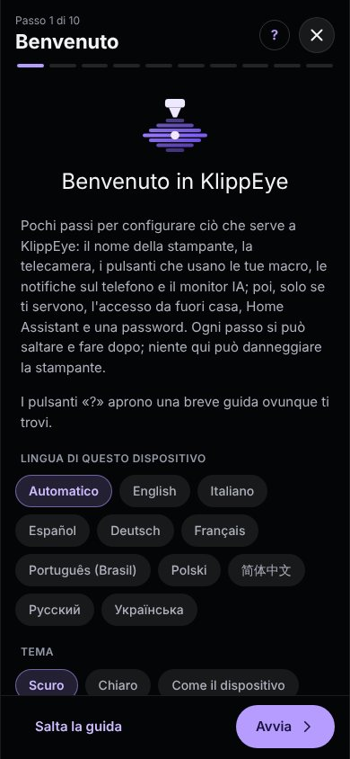
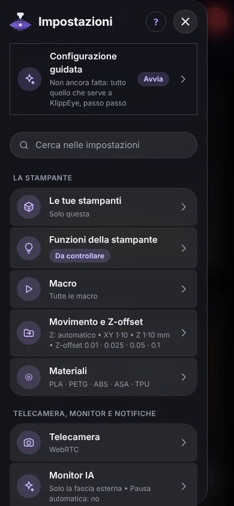
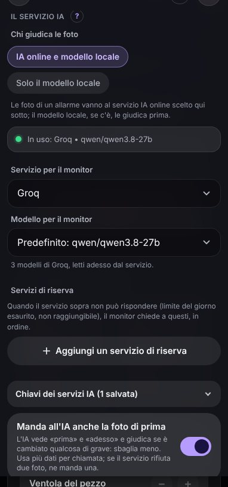
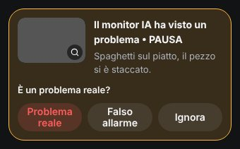
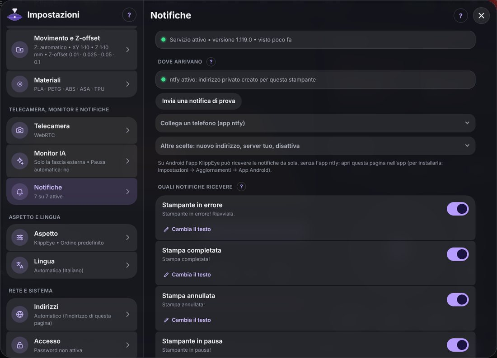
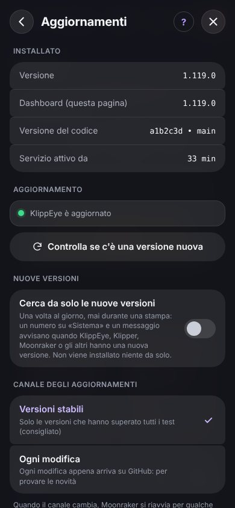

# Guida di KlippEye

Questa guida ti porta da una stampante con Klipper a una stampante che puoi guardare e comandare dal telefono, con un'IA
che tiene d'occhio le stampe. Non serve conoscere Linux: quando c'è da scrivere un comando, lo trovi già pronto da copiare.

Non serve leggerla tutta: i capitoli da 1 a 3 bastano per partire, il resto è qui per quando ti serve. Per sapere cosa fa
ogni card e ogni impostazione della dashboard c'è [Il pannello, pagina per pagina](FUNZIONI.md).

Le immagini mostrano la dashboard con dati di prova. *This guide is also available in English: [GUIDE.md](GUIDE.md).*

**Indice**

1. [Prima di cominciare](#1-prima-di-cominciare)
2. [Installazione](#2-installazione)
3. [Il primo avvio](#3-il-primo-avvio)
4. [La telecamera](#4-la-telecamera)
5. [Il monitor IA](#5-il-monitor-ia)
6. [Le notifiche sul telefono](#6-le-notifiche-sul-telefono)
7. [L'app Android](#7-lapp-android)
8. [Usarla fuori casa](#8-usarla-fuori-casa)
9. [Aggiornamenti](#9-aggiornamenti)
10. [Password e sicurezza](#10-password-e-sicurezza)
11. [Home Assistant e MQTT](#11-home-assistant-e-mqtt)
12. [Più di una stampante](#12-più-di-una-stampante)
13. [Quando qualcosa non va](#13-quando-qualcosa-non-va)
14. [Domande frequenti](#14-domande-frequenti)
15. [Togliere KlippEye](#15-togliere-klippeye)

Appendici: [A. Compilare la tua app Android](#a-compilare-la-tua-app-android) ·
[B. Dove KlippEye tiene i suoi file](#b-dove-klippeye-tiene-i-suoi-file) · [C. Comandi del terminale](#c-comandi-del-terminale)

## 1. Prima di cominciare

Ti serve:

- una stampante con Klipper e Moonraker su un Raspberry Pi o un altro computer Linux accanto alla stampante. Non importa
  come li hai installati (un'immagine già pronta, KIAUH o a mano). Se usi già un'interfaccia web per Klipper, lasciala dov'è:
  KlippEye le sta accanto e non la cambia;
- l'accesso SSH al Raspberry, solo per l'installazione. SSH è il modo di scrivere comandi sul Raspberry dal tuo computer:
  su Windows, macOS e Linux apri un terminale e scrivi `ssh <utente>@<indirizzo del Raspberry>`;
- internet sul Raspberry, per installare e aggiornare.

Utili ma non obbligatori:

- una telecamera sulla stampante, per guardare la stampa e per il monitor IA. Se la vedi già nella tua interfaccia
  attuale, KlippEye la trova;
- un telefono per le notifiche: Android con l'app KlippEye, oppure qualsiasi telefono (anche iPhone) con l'app gratuita
  ntfy.

Cosa aggiunge da solo l'installatore, solo se manca (ti chiede la password una volta):

| Pacchetto | A cosa serve |
|---|---|
| `git` | gli aggiornamenti, e la riparazione dopo un calo di corrente |
| `python3-flask`, `python3-waitress`, `python3-requests` | il servizio KlippEye che fa funzionare la dashboard |
| `python3-numpy` | la calibrazione della telecamera e il monitor IA |
| `python3-opencv` | il monitor IA, per guardare le foto della telecamera (non viene installato con `--no-ai`) |

KlippEye funziona su Raspberry Pi OS e sulle immagini per stampanti basate su di esso (Debian 11, 12 e 13), con Python 3.7 o
più recente. Sul telefono e sul computer non si installa niente: basta il browser.

## 2. Installazione

1. Collegati al Raspberry da un terminale del tuo computer:

   ```bash
   ssh pi@192.168.1.20
   ```

   Usa il tuo utente e il tuo indirizzo. Sulle immagini già pronte per stampanti l'utente di solito è `pi`. L'indirizzo è
   quello che scrivi oggi nel browser per aprire la stampante.

2. Incolla queste righe, una alla volta, premendo Invio dopo ognuna:

   ```bash
   sudo apt update && sudo apt install -y git
   git clone https://github.com/BotuPotto/KlippEye.git ~/klippeye
   bash ~/klippeye/scripts/install.sh
   ```

   La prima riga installa `git` se manca (se c'è già, non fa danni). La seconda scarica KlippEye nella cartella `klippeye`
   del tuo utente. La terza lo installa.

3. Aspetta la fine. La prima volta ci vuole qualche minuto, per via di OpenCV. Ogni passo scrive `OK`. Se qualcosa non
   va compare `WARNING` o `ERROR`, con la spiegazione di cosa fare. Alla fine leggi l'indirizzo della dashboard e
   `Moonraker sees KlippEye`.

4. Apri la dashboard: scrivi nel browser `http://<indirizzo del Raspberry>`, per esempio `http://192.168.1.20`.

   KlippEye prende l'indirizzo principale del Raspberry (la porta 80) e la pagina web che c'era si sposta sulla porta **81**
   (o sulla prima libera dopo; l'installatore ti dice quale): la raggiungi ancora da `http://192.168.1.20:81`. Se preferisci
   lasciare la pagina di prima all'indirizzo principale, scrivi `klippeye web restore`: KlippEye resta allora sulla porta
   **8085** (`http://192.168.1.20:8085`), che funziona sempre in ogni caso.

In breve, l'installatore controlla cosa manca e lo installa; crea la cartella dei tuoi dati (`~/printer_data/klippeye`), che
gli aggiornamenti non toccano mai; crea due servizi, `klippeye` (la dashboard) e `klippeye-notifier` (le notifiche), che
partono insieme al Raspberry; aggiunge il comando `klippeye` al terminale; collega KlippEye al gestore degli aggiornamenti di
Moonraker (una sezione `[update_manager klippeye]` in `moonraker.conf`, con una copia di sicurezza del file) e riavvia
Moonraker, a meno che non ci sia una stampa in corso.

Puoi rilanciare l'installatore quando vuoi: ripara quello che è rotto e lascia stare il resto.

Le opzioni si scrivono dopo `install.sh`:

| Opzione | Cosa fa |
|---|---|
| `--no-ai` | non installa OpenCV. Il monitor IA resta spento; rilancia l'installatore senza l'opzione per aggiungerlo dopo |
| `--no-packages` | non installa niente con `apt`, ti dice solo cosa manca |
| `--no-moonraker` | non tocca la configurazione di Moonraker |
| `--no-web` | lascia l'indirizzo principale del Raspberry alla pagina che ce l'ha ora (KlippEye sulla porta 8085) |
| `--channel=dev` | installa ogni modifica appena pubblicata, invece delle versioni collaudate (vedi [9](#9-aggiornamenti)) |
| `--undo` | toglie KlippEye (vedi [15](#15-togliere-klippeye)) |

Con più stampanti sullo stesso Raspberry, scegli tu la cartella dei dati:
`KLIPPEYE_PRINTER_DATA=~/printer_2_data bash ~/klippeye/scripts/install.sh`.

## 3. Il primo avvio

La prima volta che apri la dashboard parte la **configurazione guidata**. Passa in rassegna le impostazioni importanti una
alla volta, con un paio di righe di spiegazione ciascuna:

1. **Benvenuto**: la lingua e il tema (scuro o chiaro).
2. **Nome e logo** della stampante.
3. **Telecamera**: KlippEye la prende dalle impostazioni della stampante; tu controlli di vederla.
4. **Funzioni della stampante**: cosa fanno i pulsanti che usano le tue macro (parcheggio, pulizia dell'ugello, carico del
   filamento, la luce). KlippEye le cerca da solo: controllale e premi **Va tutto bene**.
5. **Notifiche**: su questo telefono con l'app, o su qualsiasi telefono con ntfy (vedi [6](#6-le-notifiche-sul-telefono)).
6. **Monitor IA**: la chiave gratuita di un'IA online, se la vuoi, e l'apprendimento dalle tue stampe (vedi
   [5](#5-il-monitor-ia)).
7. **Indirizzi**, **Home Assistant** e **Password**: solo se ti servono. Altrimenti salta.
8. **Pronta**: cosa è fatto e cosa resta.

Ogni passo si può saltare. La rifai quando vuoi da **Impostazioni → Configurazione guidata**.

<p align="center">
  
  &nbsp;
  
</p>

### Orientarsi

- Sul telefono le pagine sono in basso: **Home** (telecamera, stampa, temperature), **Controllo** (movimenti, ventole, macro,
  console), **File**, **Config** (i file di configurazione) e **Sistema** (log, servizi, aggiornamenti).
- Sul computer le stesse cose stanno su pagine più larghe, con le schede in alto.
- **☰** in alto a sinistra apre le impostazioni. La ricerca in cima trova qualsiasi impostazione: prova a scrivere
  «password» o «scuro».
- **?** nel titolo di ogni pagina spiega quella pagina.
- Le impostazioni si salvano sul Raspberry, quindi sono uguali su ogni telefono e computer. Le poche che riguardano un solo
  dispositivo (lingua, colore, disposizione delle card) lo dicono: *su questo dispositivo*.

## 4. La telecamera

Se la stampante mostra già una telecamera in un'altra interfaccia, KlippEye la usa: **Impostazioni → Telecamera → Importa
dalla stampante** prende le telecamere che Moonraker conosce.

Il monitor IA non usa il video: scatta una foto alla volta (lo *snapshot*). Per controllare che la riceva, apri
**Impostazioni → Telecamera → Snapshot (foto singola) → Prova: scatta una foto**. Vedi la foto esattamente come la riceve il
Raspberry. Con crowsnest, il programma della telecamera più usato sulle stampanti Klipper, l'indirizzo si trova da solo. Con
un'altra telecamera, scrivi lì l'indirizzo della sua foto singola.

Con più telecamere, la card della telecamera ha un menu per scegliere quale guardare. Il monitor IA guarda sempre quella di
**Impostazioni → Telecamera**.

Se la telecamera resta nera, controlla metodo e indirizzo in **Impostazioni → Telecamera**, oppure premi di nuovo *Importa
dalla stampante*. Se apri KlippEye da fuori casa, vedi il capitolo [8](#8-usarla-fuori-casa).

## 5. Il monitor IA

### Come funziona

Durante una stampa KlippEye guarda la telecamera ogni pochi secondi, sul Raspberry stesso. Ogni foto la guardano in due:

- un rilevamento del movimento, che si accorge quando qualcosa sul piatto cambia e resta cambiato (senza badare alla luce
  e alla testina che passa);
- un modello locale, una piccola IA per immagini addestrata su foto di stampe fallite, che arriva con KlippEye e funziona
  senza internet. Dà un voto agli allarmi del rilevamento del movimento e guarda anche da solo ogni 15 secondi.

Cosa succede dopo dipende dalla tua scelta in **Impostazioni → Monitor IA → Il servizio IA → Chi giudica le foto**:

- **IA online e modello locale** (la scelta di partenza): quando il modello locale ha un dubbio, o è sicuro che ci sia un
  problema, la foto va a un'IA online (Google Gemini, Groq, OpenAI e altre) che dà l'ultima parola. È più precisa, e con
  una chiave gratuita non costa niente. Partono solo le foto di un allarme, mai tutta la stampa.
- **Solo il modello locale**: nessuna foto esce dal Raspberry. Decide da solo il modello locale: quando è sicuro per tre
  sguardi di fila, propone una pausa.

<p align="center"></p>

L'indicatore **IA** in alto nella dashboard ti dice come va: grigio senza stampa, verde se è tutto a posto, arancione o rosso
con un allarme. Toccalo per vedere l'ultima foto e il giudizio dell'IA.

### Una chiave gratuita per l'IA online

Serve solo con *IA online e modello locale*. Google Gemini, Groq e Mistral hanno un piano gratuito.

1. Apri **Impostazioni → Monitor IA → Il servizio IA**.
2. In *Chiavi dei servizi IA* tocca **Ottieni una chiave** accanto al servizio (Google Gemini va bene per cominciare).
3. Accedi al sito del servizio, crea una chiave e copiala.
4. Incollala in KlippEye e salva. La pagina mostra solo gli ultimi 4 caratteri.
5. Scegli il modello: *Predefinito* è uno che KlippEye sa che funziona. Al monitor serve un modello che *vede le immagini*
   (sono in cima all'elenco).

La chiave resta sul Raspberry, in un file che può leggere solo il servizio KlippEye. I piani gratuiti hanno un limite al
giorno: quando è finito, KlippEye aspetta che il servizio lo permetta di nuovo. Per non lasciare scoperto il monitor nel
frattempo, aggiungi fino a tre **Servizi di riserva** nella stessa pagina.

### Cosa fa quando vede un problema

In **Quando vede un problema** (stessa pagina) scegli:

- **Fiducia minima dell'IA**: quanto deve essere sicura l'IA online. 70% è un buon inizio. Se ti disturba con problemi
  dubbi, alzala all'80%. Sopra l'85% può lasciar correre un guasto vero;
- quali difetti contano: spaghetti, piatto vuoto (il pezzo si è staccato), layer spostati, warping;
- **Controlli di fila**: quanti giudizi di fila devono essere d'accordo prima di avvisarti;
- **Metti in pausa da solo** e **Annulla da solo**: all'inizio sono spenti tutti e due. L'IA può sbagliare e una stampa
  annullata non si riprende, quindi comincia con le sole notifiche e accendi la pausa quando ti fidi.

Prima di mettere in pausa o annullare, l'IA guarda due volte: 40 secondi dopo le si chiede di nuovo su una foto nuova, e la
stampa si ferma solo se vede di nuovo il problema. Un riflesso o la testina che passa nel frattempo sono spariti, un guasto
vero è ancora lì. Il
giudizio «piatto vuoto» (il pezzo si è staccato) è il più facile da sbagliare, quindi conta solo se l'IA ha visto il pezzo
nella foto di prima e lo vede sparito in quella nuova, ne è sicura almeno all'85%, la stampa è già alta 2 mm e il pezzo misura
almeno 2 cm. All'IA viene anche detto quanto è grande il pezzo e, con la telecamera calibrata, dove dovrebbe trovarsi
nell'immagine.

Quando l'IA dà un allarme, la card della stampa ti chiede: **Problema reale**, **Falso allarme** o **Ignora**. La tua
risposta chiude l'allarme e aiuta a misurare il monitor.

<p align="center"></p>

### Calibrare la telecamera (consigliato)

Senza calibrazione il monitor guarda solo la fascia esterna di un rettangolo dell'immagine, lontano dal pezzo. Con la
calibrazione sa dove appare nell'immagine ogni punto della stampante: guarda **tutto il piatto tranne dove ci sono i pezzi**,
e lascia fuori testina e gantry, che sono la causa principale dei falsi allarmi. Ci vuole circa un quarto d'ora, una volta
sola; si rifà solo se sposti la telecamera.

Prima di cominciare: piatto pulito, la luce come durante le stampe, stampante ferma. Durante la calibrazione la stampante si
muove da sola: tieni le mani lontane.

1. Apri **Impostazioni → Monitor IA → Calibrazione della telecamera**.
2. **Come si muove l'asse Z?** Il piatto (la maggior parte delle CoreXY) o la testina. KlippEye propone la risposta leggendo
   la tua configurazione. Le stampanti con il piatto che va avanti e indietro (bed slinger) non sono ancora supportate.
3. Fai l'**homing** della stampante.
4. Segni (solo quando Z muove il piatto). Il modo migliore: **Scarica i segni (STL)**, sei piccole piramidi già messe al
   posto giusto per il tuo piatto, stampale con le tue impostazioni di sempre e lasciale sul piatto; poi scegli il G-code che
   hai stampato e **Leggi i segni da questo file**. Il modo veloce: **Crea le 6 gocce**, sei gocce di filamento.
5. I 12 punti. Per ognuno premi **Vai al punto**, tocca l'immagine dove sta il punto, toccalo di nuovo con precisione
   nella vista ingrandita e premi **Tieni questo punto**. La pagina mostra un piccolo disegno di cosa toccare: la punta
   dell'ugello, oppure la cima di un segno. Dopo il primo punto, **Trova l'ugello da solo** può fare per te gli altri punti
   dell'ugello.
6. **Calcola la calibrazione.** Un buon risultato ha un errore di pochi pixel; i punti in rosso sono stati toccati nel posto
   sbagliato: rifai solo quelli. Poi **Salva la calibrazione** e togli i segni dal piatto.
7. Testina e gantry: l'immagine dal vivo li mostra contornati in viola e arancione. Trascina i pallini (o usa − e +) in
   modo che i contorni li coprano con un po' di margine.

Ogni dieci minuti KlippEye controlla che la telecamera non si sia spostata. Se si è spostata, la pagina lo dice e il monitor
smette di usare la calibrazione finché non la rifai.

### Insegnargli com'è la tua stampante

A fine stampa una card chiede **Com'è andata la stampa?**. Rispondi *Andata bene* oppure *C'era un problema* (con il momento
in cui è comparso): ci vuole un secondo. Con **Impara dalle stampe di questa stampante** acceso (Impostazioni → Monitor IA →
Modello locale), il modello locale usa le tue risposte per imparare com'è la tua stampante. Impara sul Raspberry, e le foto
non escono mai da lì. Comincia a contare quando ha almeno 5 foto di stampe fallite e 20 di stampe riuscite.

### Misurarlo

Per sapere se un cambio delle impostazioni aiuta davvero, **Impostazioni → Monitor IA → Registrazioni → Registra le stampe**
tiene le foto che il monitor ha guardato (circa 150 MB per una stampa di quattro ore; le più vecchie si cancellano quando lo
spazio è pieno). Dopo una stampa, digli se è andata bene o da quale foto è fallita. **Misura adesso** fa girare di nuovo il
monitor su quelle stampe e ti dice quanti allarmi all'ora avresti, quanti erano falsi e se ogni guasto è stato preso.

### Se non si comporta bene

| Cosa succede | Cosa provare |
|---|---|
| allarmi quando passa la testina | calibra la telecamera; controlla il contorno di testina e gantry; in *Soglie del monitor* alza *Controlli di fila in cui il cambiamento deve restare* da 3 a 4 |
| allarmi quando cambia la luce | sistema l'esposizione della telecamera; attenua un LED troppo forte; lascia il cambio di luce a 30 |
| l'IA segnala problemi dubbi | alza *Fiducia minima dell'IA* dal 70% all'80% |
| un guasto vero passa inosservato | calibra la telecamera; in *Registrazioni* guarda gli allarmi: uno arancione vuol dire che la fiducia era troppo alta |
| "AI error 429" su un allarme | il servizio online rifiuta altre richieste (il suo limite al minuto o al giorno). Alza *Pausa tra due analisi dell'IA*, spegni *Manda all'IA anche la foto di prima*, aggiungi un servizio di riserva, oppure usa *Solo il modello locale* |
| il monitor non chiama mai l'IA | controlla la chiave e il modello; controlla che OpenCV sia installato (`sudo apt install python3-opencv`) e che *Monitor attivo* sia acceso |

## 6. Le notifiche sul telefono

KlippEye avvisa il telefono quando una stampa finisce, si ferma per un errore, va in pausa, resta senza
filamento, o quando l'IA vede un problema. Le notifiche viaggiano con [ntfy](https://ntfy.sh), un servizio gratuito
senza account e senza chiavi: KlippEye crea un indirizzo privato che conoscono solo i tuoi telefoni.

### Con l'app KlippEye (Android)

La prima volta che apri l'app, ti chiede se ricevere le notifiche su questo telefono. Tocca **Imposta** e segui i cinque
passi (li trovi anche in **Impostazioni → Notifiche → Questo telefono**):

1. **Consenti le notifiche** nella finestra di Android.
2. **Crea l'indirizzo privato sul Raspberry** (un tocco).
3. **Ricevi su questo telefono**. L'app resta in ascolto anche quando è chiusa e dopo il riavvio del telefono. Una piccola
   notifica fissa mostra che è in ascolto: tienila premuta per nasconderla.
4. **Lascia KlippEye sveglia**: permetti all'app di funzionare senza limiti di batteria. Altrimenti Android la addormenta e
   le notifiche arrivano in ritardo.
5. **Controlla che arrivi**: KlippEye manda una prova e la pagina conferma quando arriva sul telefono.

### Con l'app ntfy (iPhone e altri telefoni)

1. Installa l'app gratuita **ntfy** (App Store, Google Play o F-Droid).
2. In KlippEye apri **Impostazioni → Notifiche** e, in *Altri telefoni*, inquadra il codice QR con la fotocamera del
   telefono. Dal telefono stesso basta toccare *Apri nell'app ntfy*.
3. Manda una notifica di prova.

Più telefoni possono inquadrare lo stesso codice. Chi ha l'indirizzo può leggere le tue notifiche, quindi non condividere il
codice. Se dovesse sfuggire, **Nuovo indirizzo** ne crea un altro (i telefoni con ntfy devono inquadrarlo di nuovo).

<p align="center"></p>

### Scegliere cosa arriva

In **Impostazioni → Notifiche** scegli quali notifiche arrivano e in che lingua. Sotto ognuna, *Cambia il testo* ti fa
scrivere il tuo, con le parole tra graffe riempite al momento dell'invio: `{file}`, `{progress}`, `{remaining}`, `{layer}`,
`{message}` (il motivo di un errore secondo Klipper) e altre.

**Le tue notifiche** ne aggiunge altre: *Stampa avviata*, *Avanzamento raggiunto*, *Manca poco*, *Layer raggiunto*, *Una
riga nella console* (parole che le tue macro scrivono con `M118` o `RESPOND`), *Temperatura raggiunta*. Ognuna si può segnare
come *Importante*, per farla arrivare come un allarme.

Se non arriva niente, sul Raspberry `klippeye notify check` elenca cosa manca e `klippeye notify test` manda una prova.

## 7. L'app Android

L'app mostra la dashboard a schermo intero, riceve le notifiche, scarica i file e si aggiorna da sola.

- Per installarla, dal telefono apri la dashboard nel browser → **Impostazioni → Aggiornamenti → App Android → Scarica
  l'app**. Apri il file scaricato e permetti l'installazione di app da questa fonte.
- Al primo avvio chiede l'indirizzo del Raspberry (quello che scrivi nel browser, per esempio `192.168.1.20`) e, se usi una
  VPN, l'indirizzo da usare fuori casa. Li cambi poi in **Impostazioni → Indirizzi**.
- Quando c'è un'app nuova, **Impostazioni → Aggiornamenti → App Android → Aggiorna l'app**. Android chiede sempre di
  confermare.
- Il tasto **indietro** del telefono chiude la finestra aperta o torna alla pagina precedente. I link ad altri siti si aprono
  nel browser.

Se Android rifiuta di installare un aggiornamento, permetti *Installa app sconosciute* per KlippEye. Sui telefoni Samsung
l'*Auto Blocker* deve essere spento (Impostazioni → Sicurezza e privacy → Auto Blocker).

## 8. Usarla fuori casa

KlippEye è pensata per la rete di casa. **Non aprire mai le sue porte (80, 443, 8085) su internet dal router.** Per
raggiungere la stampante da fuori usa una VPN, una rete privata tra i tuoi dispositivi: ZeroTier e Tailscale sono gratuiti
per l'uso in casa e si configurano in pochi minuti.

**Impostazioni → Indirizzi → Da fuori casa con ZeroTier: la guida** ti accompagna con ZeroTier in sei passi, con i comandi da
copiare. Poi scrivi in **Impostazioni → Indirizzi** l'indirizzo del Raspberry nella rete di casa e quello nella VPN. L'app li
prova a turno, e la telecamera usa quello giusto.

## 9. Aggiornamenti

**Impostazioni → Aggiornamenti → Controlla se c'è una versione nuova → Aggiorna KlippEye.** Il servizio si riavvia per
qualche secondo e la pagina si ricarica da sola. Impostazioni, chiavi e notifiche restano come sono. Durante una stampa il
pulsante è disattivato.

<p align="center"></p>

Una volta al giorno (mai durante una stampa) la dashboard chiede a Moonraker se KlippEye, Klipper, Moonraker o gli altri
programmi hanno versioni nuove. Se sì, compare un numero sulla scheda **Sistema**. Non si installa niente senza di te.

Il canale degli aggiornamenti (stessa pagina):

- **Versioni stabili** (la scelta di partenza): solo le versioni che hanno passato tutti i test automatici;
- **Ogni modifica**: ogni modifica appena pubblicata, per chi vuole provare prima le novità.

| Se… | allora… |
|---|---|
| la versione nuova non va come speravi | **Torna alla versione precedente**, nella stessa pagina |
| la pagina dice che i file del programma sono stati cambiati a mano | **Ripristina i file del programma** (le tue impostazioni non si toccano) |
| la dashboard non si apre proprio | sul Raspberry: `klippeye update --force` rimette il programma com'è su GitHub |

## 10. Password e sicurezza

**Password** (facoltativa): **Impostazioni → Accesso**, scrivila due volte, **Attiva la password**. Il dispositivo che stai
usando resta collegato; gli altri, anche l'app, la chiedono una volta e la ricordano per sei mesi. Dalla stessa pagina la
cambi, la togli e scolleghi gli altri dispositivi. Se l'hai dimenticata, sul Raspberry `klippeye password remove` la toglie
e `klippeye password` ne imposta una nuova.

**Password ospiti**: chi entra con questa guarda la stampante, la telecamera, i file e la cronologia, ma non manda comandi,
non avvia né ferma stampe e non apre configurazione e impostazioni.

I controlli di rete sono sempre attivi: KlippEye risponde solo se chiamata con un indirizzo IP, il nome del Raspberry o un
nome della rete di casa (`.local`, `.lan`…), e rifiuta i comandi che arrivano da pagine di altri siti. Per usare un nome tuo,
per esempio con un tuo dominio: `klippeye access host-add stampante.esempio.it`.

La password protegge solo KlippEye. Moonraker (porta 7125) e le altre interfacce della stampante hanno le loro impostazioni,
e il traffico nella rete di casa non è cifrato: un motivo in più per usare una VPN da fuori.

## 11. Home Assistant e MQTT

**Impostazioni → Home Assistant / MQTT** collega la stampante a un broker MQTT. Con Home Assistant:

1. Installa il componente aggiuntivo **Mosquitto broker** (Home Assistant → Impostazioni → Componenti aggiuntivi).
2. Crea un utente apposta (Impostazioni → Persone → Utenti).
3. In KlippEye scrivi l'indirizzo di Home Assistant, la porta **1883**, quell'utente e la sua password.
4. **Prova il collegamento**, poi **Salva**.

La stampante compare da sola in Home Assistant (Impostazioni → Dispositivi e servizi → MQTT) con lo stato, l'avanzamento, il
tempo che manca, le temperature, il monitor IA, i pulsanti **Pausa** e **Riprendi** e le luci. **Annulla stampa** compare
solo se accendi *Permetti di annullare la stampa*.

Node-RED, openHAB, ioBroker e simili leggono gli stessi valori su topic MQTT semplici, elencati nella pagina. Per i tuoi
script c'è anche un'API HTTP: [API.md](API.md) (in inglese).

## 12. Più di una stampante

Ogni stampante ha il suo KlippEye. In **Impostazioni → Le tue stampanti** aggiungi le altre con il loro indirizzo (*Prova*
controlla che rispondano). Poi un tocco sul nome della stampante in alto passa dall'una all'altra, e la **Panoramica** le
mostra tutte insieme, con stato e temperature.

## 13. Quando qualcosa non va

Se chiedi aiuto, allega il rapporto di diagnostica: **Impostazioni → Aggiornamenti → Diagnostica → Scarica il rapporto di
diagnostica**, oppure `klippeye diagnose --save` sul Raspberry. Non contiene password, chiavi o token.

| Cosa vedi | Cosa fare |
|---|---|
| la dashboard non si apre | sul Raspberry: `klippeye status`, poi `klippeye restart`. `klippeye log` mostra le ultime righe del log |
| «questo nome non è permesso» | aprila con l'indirizzo IP, oppure permetti il nome: `klippeye access host-add NOME` |
| Moonraker non conosce KlippEye | rilancia `bash ~/klippeye/scripts/install.sh`, poi riavvia Moonraker |
| la telecamera resta nera | vedi il capitolo [4](#4-la-telecamera) |
| nessuna notifica | `klippeye notify check` e `klippeye notify test` |
| il monitor IA si comporta male | vedi [Se non si comporta bene](#se-non-si-comporta-bene) |
| l'app non installa un aggiornamento | vedi il capitolo [7](#7-lapp-android) |
| il Raspberry sembra lento | `klippeye benchmark`, meglio durante una stampa: misura per 30 secondi e dice in parole semplici se c'è margine |

### Dopo un calo di corrente

Un calo di corrente mentre il Raspberry scrive può lasciare un file rovinato. KlippEye si ripara da sola, senza internet:
prima di ogni avvio confronta i suoi file con la copia che tiene git e rimette a posto quelli danneggiati. Le tue
impostazioni e la configurazione della stampante non vengono mai toccate. `klippeye repair log` ti dice cosa è stato
ripristinato.

Se cambi a mano i file del programma di proposito, crea prima il file `~/printer_data/klippeye/no-repair`, altrimenti la
riparazione li rimette com'erano.

## 14. Domande frequenti

**Sostituisce la mia interfaccia di Klipper?** No, a meno che tu non voglia. KlippEye le lavora accanto: stesso Klipper,
stesso Moonraker, stessi file. Puoi tenerle aperte tutte e due insieme.

**Cambia la configurazione della stampante?** Solo quando glielo chiedi. Se lasci che KlippEye crei una macro (in *Funzioni
della stampante*), la scrive nel suo file `klippeye_macros.cfg` e aggiunge una riga `[include]` a `printer.cfg`, con una
copia di sicurezza.

**Serve internet?** Per installare e aggiornare sì. La dashboard, la telecamera e l'IA locale funzionano anche senza. Le
notifiche e l'IA online ne hanno bisogno.

**Manda da qualche parte le foto delle mie stampe?** Solo all'IA online che scegli, e solo le foto di un allarme. Con *Solo
il modello locale* non esce niente dal Raspberry.

**È gratis?** Sì, KlippEye è software libero. I servizi di IA online hanno piani gratuiti con un limite al giorno; quelli a
pagamento li scegli tu.

**Rallenta le stampe?** Il monitor gira a bassa priorità e Klipper ha la precedenza. Sui Raspberry Pi più vecchi (3 o Zero
2), `klippeye benchmark` ti dice se c'è margine.

**E l'iPhone?** La dashboard funziona in Safari e le notifiche arrivano con l'app ntfy. L'app KlippEye esiste solo per
Android.

## 15. Togliere KlippEye

Sul Raspberry:

```bash
klippeye undo-install
```

Toglie i servizi, il comando `klippeye` e la voce nel gestore degli aggiornamenti di Moonraker. La cartella dei tuoi dati
(`~/printer_data/klippeye`) e i pacchetti installati restano; cancella a mano le cartelle `~/klippeye` e
`~/printer_data/klippeye` se vuoi eliminare anche quelle. Se KlippEye aveva preso l'indirizzo principale del Raspberry, la
pagina che c'era prima lo riavrà.

## A. Compilare la tua app Android

Ti serve solo se modifichi l'app tu stesso. L'app pubblicata con KlippEye è già compilata e firmata.

GitHub compila l'app gratis nei repository pubblici:

1. Fai un fork del repository su GitHub e installa KlippEye dal tuo fork
   (`git clone https://github.com/<tu>/KlippEye.git ~/klippeye`).
2. La password della chiave di firma. Android aggiorna un'app solo se è firmata con la stessa chiave. GitHub crea la chiave
   la prima volta e la cifra con una password che scegli tu: nel tuo repository vai in **Settings → Secrets and variables →
   Actions → New repository secret**, nome **`KLIPPEYE_CHIAVE_PASSWORD`**, valore una frase lunga (almeno 16 caratteri, su
   una riga). Conservala in un posto sicuro.
3. **Settings → Actions → General → Workflow permissions → Read and write permissions**, così il workflow può salvare l'app
   in `apk/`.
4. **Actions → Android app → Run workflow.** Dopo 5-10 minuti l'app è in `apk/`. Aggiorna KlippEye dalla dashboard e installa
   l'app da *Impostazioni → Aggiornamenti → App Android* (prima disinstalla un'app firmata con un'altra chiave).
5. Per una versione nuova dell'app alza il numero in `android/VERSION` (per esempio `1.8.1`); GitHub la compila da solo.

Quando il workflow si ferma, spiega il motivo in parole semplici (un segreto mancante, una password corta, una chiave
diversa…). Dettagli tecnici, in inglese: [android/README.md](../android/README.md).

## B. Dove KlippEye tiene i suoi file

| Dove | Cosa |
|---|---|
| `~/klippeye` | il programma, una copia di questo repository. Non cambiarlo a mano: Moonraker si rifiuterebbe di aggiornarlo |
| `~/printer_data/klippeye` | i tuoi dati: impostazioni del monitor, chiavi, password (solo l'impronta), notifiche, allarmi, registrazioni, copie di sicurezza. Copia questa cartella per avere un backup |
| i servizi `klippeye` e `klippeye-notifier` | partono all'avvio. Non rinominare `klippeye`: Moonraker lo riavvia dopo un aggiornamento |
| il database di Moonraker, namespace `klippeye` | le impostazioni della dashboard condivise da tutti i tuoi dispositivi |

L'installatore aggiunge questa sezione a `moonraker.conf`:

```ini
[update_manager klippeye]
type: git_repo
path: ~/klippeye
origin: https://github.com/BotuPotto/KlippEye.git
primary_branch: main
channel: stable
managed_services: klippeye
```

## C. Comandi del terminale

Si scrivono sul Raspberry. Ti serviranno di rado: le cose di tutti i giorni si fanno dalla dashboard. Per abitudine i
comandi sono in inglese, ma i vecchi nomi italiani (`stato`, `riavvia`, `aggiorna`…) funzionano ancora.

| Comando | Cosa fa |
|---|---|
| `klippeye status` | se i servizi girano e la dashboard risponde |
| `klippeye version` | la versione installata |
| `klippeye log` · `klippeye log notifier` | le ultime righe del log della dashboard o delle notifiche |
| `klippeye restart` · `restart notifier` · `restart all` | riavvia i servizi |
| `klippeye update` · `update --force` | aggiorna a mano; `--force` butta via le modifiche fatte a mano |
| `klippeye repair` · `repair log` | controlla subito i file del programma · dice cosa è stato ripristinato |
| `klippeye notify test` · `notify check` | manda una notifica di prova · elenca cosa manca |
| `klippeye password` · `password remove` | imposta · toglie la password della dashboard (anche `status`, `logout-all`, `guest-set`, `guest-remove`) |
| `klippeye access host-add NOME` | permette un altro nome per la dashboard (anche `host-remove`, `network-checks on/off`, `status`) |
| `klippeye diagnose` · `diagnose --save` | il rapporto da allegare quando chiedi aiuto |
| `klippeye benchmark` | quanto processore e memoria usano i programmi della stampante |
| `klippeye replay` | fa rigirare il monitor IA sulle stampe registrate (opzioni in cima a `scripts/replay.py`) |
| `klippeye web main` · `web restore` · `web status` | KlippEye all'indirizzo principale del Raspberry, o di nuovo sulla porta 8085 |
| `klippeye undo-install` | toglie KlippEye |
| `klippeye help` | l'elenco dei comandi |
