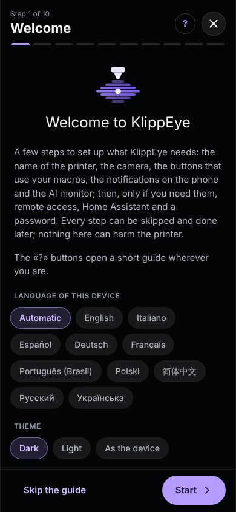
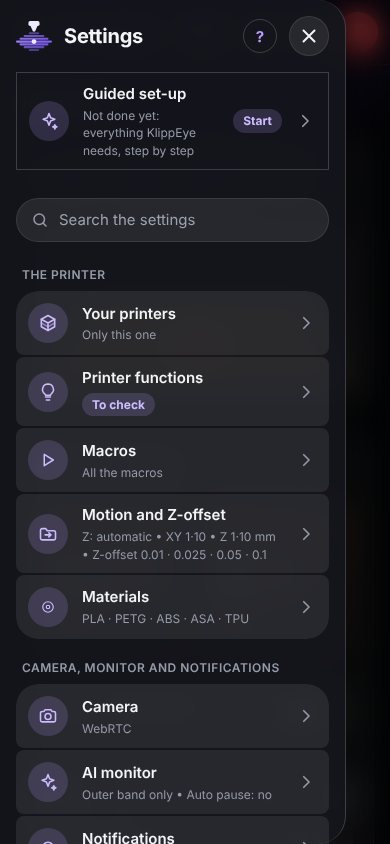
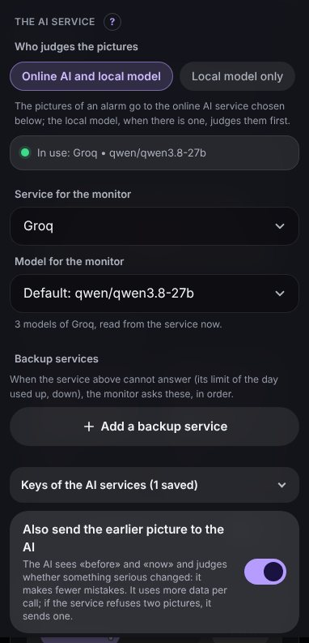
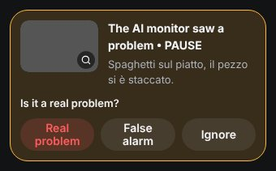
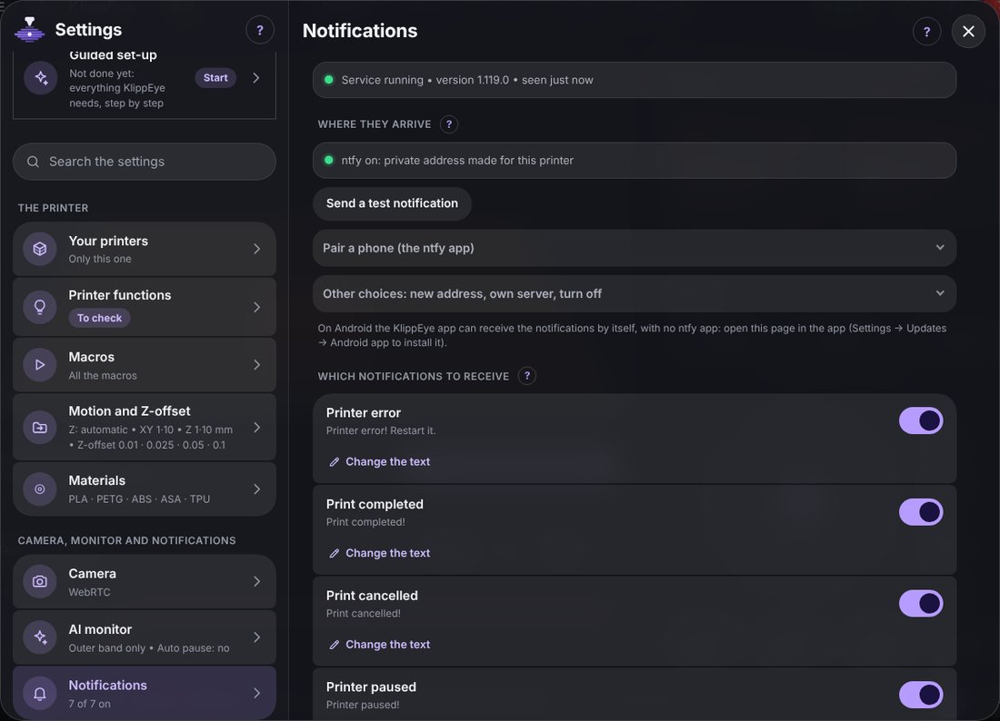
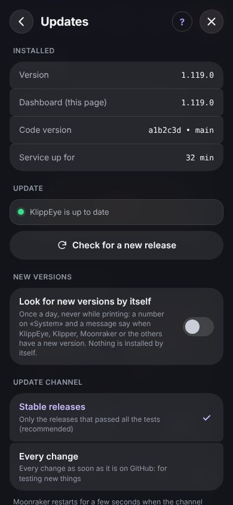

# KlippEye user guide

This guide takes you from a printer with Klipper to a printer you can watch and control from your phone, with an AI that
keeps an eye on your prints. You don't need to know Linux: when a command is needed, it is written out for you to copy.

You don't have to read it all: chapters 1 to 3 get you going, and the rest is here for when you need it. For what
each card and setting of the dashboard does, see [The dashboard, page by page](FEATURES.md).

The pictures show the dashboard with demo data. *Questa guida c'è anche in italiano: [GUIDA.md](GUIDA.md).*

**Contents**

1. [Before you start](#1-before-you-start)
2. [Install](#2-install)
3. [First start](#3-first-start)
4. [The camera](#4-the-camera)
5. [The AI monitor](#5-the-ai-monitor)
6. [Notifications on your phone](#6-notifications-on-your-phone)
7. [The Android app](#7-the-android-app)
8. [Using it away from home](#8-using-it-away-from-home)
9. [Updates](#9-updates)
10. [Password and security](#10-password-and-security)
11. [Home Assistant and MQTT](#11-home-assistant-and-mqtt)
12. [More than one printer](#12-more-than-one-printer)
13. [When something goes wrong](#13-when-something-goes-wrong)
14. [Questions people ask](#14-questions-people-ask)
15. [Removing KlippEye](#15-removing-klippeye)

Appendices: [A. Building your own Android app](#a-building-your-own-android-app) ·
[B. Where KlippEye keeps its files](#b-where-klippeye-keeps-its-files) · [C. Terminal commands](#c-terminal-commands)

## 1. Before you start

You need:

- a printer running Klipper and Moonraker on a Raspberry Pi or another Linux computer next to the printer. It doesn't
  matter how you installed them (a ready-made printer image, KIAUH or by hand). If you already have a web interface for
  Klipper, leave it there: KlippEye lives next to it and doesn't change it;
- SSH access to the Raspberry, only for the installation. SSH is the way to type commands on the Raspberry from your
  computer: on Windows, macOS and Linux open a terminal and type `ssh <user>@<address of the Raspberry>`;
- internet on the Raspberry, to install and to update.

Nice to have:

- a camera on the printer, to watch the print and for the AI monitor. If you see the camera in your current interface,
  KlippEye will find it;
- a phone for notifications: Android with the KlippEye app, or any phone (iPhone too) with the free ntfy app.

What the installer adds by itself, only if it is missing (it asks for your password once):

| Package | What for |
|---|---|
| `git` | updates, and repairing itself after a power cut |
| `python3-flask`, `python3-waitress`, `python3-requests` | the KlippEye service that serves the dashboard |
| `python3-numpy` | the camera calibration and the AI monitor |
| `python3-opencv` | the AI monitor, to look at the camera's pictures (left out with `--no-ai`) |

KlippEye works on Raspberry Pi OS and the printer images built on it (Debian 11, 12 and 13) with Python 3.7 or newer.
Nothing is installed on your phone or computer: a browser is enough.

## 2. Install

1. Connect to the Raspberry from a terminal on your computer:

   ```bash
   ssh pi@192.168.1.20
   ```

   Use your own user and address. On ready-made printer images the user is usually `pi`. The address is the one you type in
   the browser to open your printer today.

2. Paste these lines, one at a time, pressing Enter after each:

   ```bash
   sudo apt update && sudo apt install -y git
   git clone https://github.com/BotuPotto/KlippEye.git ~/klippeye
   bash ~/klippeye/scripts/install.sh
   ```

   The first line installs `git` if it is missing (if it is already there, it does no harm). The second downloads KlippEye
   into the `klippeye` folder of your user. The third installs it.

3. Wait for the end. The first time it takes a few minutes, because of OpenCV. Each step prints `OK`. If something is
   wrong you see `WARNING` or `ERROR` with an explanation of what to do. At the end you read the address of the dashboard and
   `Moonraker sees KlippEye`.

4. Open the dashboard: type `http://<address of the Raspberry>` in your browser, for example `http://192.168.1.20`.

   KlippEye takes the Raspberry's main address (port 80), and the web page that was there moves to port **81** (or the
   next free one; the installer tells you which): you can still reach it at `http://192.168.1.20:81`. If you'd rather keep the old page on the main address, run
   `klippeye web restore`: KlippEye then stays at port **8085** (`http://192.168.1.20:8085`), which always works anyway.

What the installer does, in short: it checks what is missing and installs it; it creates the folder of your data
(`~/printer_data/klippeye`), which updates never touch; it creates two services, `klippeye` (the dashboard) and
`klippeye-notifier` (the notifications), that start with the Raspberry; it adds the `klippeye` command to the terminal;
it adds KlippEye to Moonraker's update manager (an `[update_manager klippeye]` section in `moonraker.conf`, with a backup of
the file) and restarts Moonraker, unless a print is running.

You can run the installer again whenever you want: it repairs what is broken and leaves the rest alone.

Options (add them after `install.sh`):

| Option | What it does |
|---|---|
| `--no-ai` | doesn't install OpenCV. The AI monitor stays off; run the installer again without it to add it later |
| `--no-packages` | installs nothing with `apt`, it only tells you what is missing |
| `--no-moonraker` | doesn't touch Moonraker's configuration |
| `--no-web` | leaves the Raspberry's main address to the page that has it now (KlippEye on port 8085) |
| `--channel=dev` | installs every change as soon as it is published, instead of the tested releases (see [9](#9-updates)) |
| `--undo` | removes KlippEye (see [15](#15-removing-klippeye)) |

With more than one printer on the same Raspberry, choose the data folder by hand:
`KLIPPEYE_PRINTER_DATA=~/printer_2_data bash ~/klippeye/scripts/install.sh`.

## 3. First start

The first time you open the dashboard, the guided set-up starts. It goes through the important settings one at a time,
with a couple of lines of explanation each:

1. **Welcome**: the language and the theme (dark or light).
2. **Name and logo** of the printer.
3. **Camera**: KlippEye takes it from the printer's settings; you check that you can see it.
4. **Printer functions**: what the buttons that use your macros do (park, clean the nozzle, load filament, the light).
   KlippEye looks for them by itself: check them and press **All right**.
5. **Notifications**: on this phone with the app, or on any phone with ntfy (see [6](#6-notifications-on-your-phone)).
6. **AI monitor**: the free key of an online AI, if you want one, and learning from your prints (see [5](#5-the-ai-monitor)).
7. **Addresses**, **Home Assistant** and **Password**: only if you need them. Otherwise skip.
8. **Ready**: what is done and what is left.

Each step can be skipped. You can run it again from **Settings → Guided set-up**.

<p align="center">
  
  &nbsp;
  
</p>

### Finding your way around

- On a phone the pages are at the bottom: **Home** (camera, print, temperatures), **Control** (moves, fans, macros,
  console), **Files**, **Config** (the configuration files) and **System** (logs, services, updates).
- On a computer the same things are arranged on wider pages, with the tabs at the top.
- **☰** at the top left opens the settings. The search box at their top finds any setting: try typing «password» or
  «dark».
- **?** in the title of each page explains that page.
- The settings are saved on the Raspberry, so they are the same on every phone and computer. The few that belong to a single
  device (language, colour, layout of the cards) say *on this device*.

## 4. The camera

If your printer already shows a camera in another interface, KlippEye uses it: **Settings → Camera → Import from the
printer** takes the cameras Moonraker knows.

The AI monitor doesn't use the video: it takes one still picture at a time (the *snapshot*). To check that it gets one,
open **Settings → Camera → Snapshot (single photo) → Try: take a photo**. You see the picture exactly as the Raspberry gets
it. With crowsnest, the usual camera software of Klipper printers, the address is found by itself. With another camera,
write the address of its single photo there.

With more than one camera, the camera card has a menu to choose which one you watch. The AI monitor always watches the one
in **Settings → Camera**.

The camera stays black? Check the method and the address in **Settings → Camera**, or press *Import from the
printer* again. If you open KlippEye from outside your home, see [8](#8-using-it-away-from-home).

## 5. The AI monitor

### How it works

While a print runs, KlippEye looks at the camera every few seconds, on the Raspberry itself. Two things look at each
picture:

- a motion detection (OpenCV) that notices when something on the bed changes and stays changed (ignoring the light and
  the toolhead going by);
- a local model, a small image AI trained on photos of failed prints, which comes with KlippEye and runs without
  internet. Every 15 seconds it rates how likely the picture shows a failed print. It looks at the whole picture and,
  with a calibrated camera, closer at the part.

The two help each other. When OpenCV sees a change, the local model looks at once, closer at that spot, and keeps
looking there for five minutes. When the local model has a doubt, OpenCV raises an alarm sooner for a minute.

In the AI monitoring panel (tap the **AI** badge) each one has its tile, with the last score and the highest of the
print. OpenCV's score goes back to 0% once a change stops changing: a part that came off and lies still becomes part
of its background. That is normal, and it is why the local model keeps an eye on it. **Try the local model now** rates
the camera's picture there and then: put something in front of the camera and see whether it recognises it.

**It learns from its false alarms.** Mark an alarm as *False alarm* (on the print card or in the alarm list) and the local
model remembers that scene: a picture like it, rated not much higher, no longer counts as a doubt or as sure, so no alarm,
no pause and no online question. When the online AI finds nothing where the local model had a doubt, the scene is
remembered for a few hours. What it learned is kept apart from the recordings (deleting them forgets nothing) and
survives a new local model. *Real problem* on the same alarm forgets the scene; **Settings → AI monitor → Local model →
Forget the false alarms it learned** forgets them all.

**The purge is hidden.** With a calibrated camera, KlippEye compares the bed when the print starts with the bed when the
real print starts. What appeared outside the parts (a purge line, also an adaptive one next to the print area, a blob)
is covered with the empty bed before the local model looks, and OpenCV ignores it.

What happens next depends on your choice in **Settings → AI monitor → The AI service → Who judges the pictures**:

- **Online AI and local model** (the usual choice): when the local model has a doubt, or is sure there is a problem, the
  picture goes to an online AI (Google Gemini, Groq, OpenAI and others) that gives the final word. It is more precise,
  and with a free key it costs nothing. Only the pictures of an alarm are sent, never the whole print.
- **Local model only**: no picture leaves the Raspberry. The local model decides alone: when it is sure for three looks in a
  row, it proposes a pause.

<p align="center"></p>

The **AI** badge at the top of the dashboard tells you how it is going: grey with no print, green when all is well, amber
or red with an alarm. Tap it to see the last picture and the AI's verdict.

### Getting a free key for the online AI

You need it only for *Online AI and local model*. Google Gemini, Groq and Mistral have a free plan.

1. Open **Settings → AI monitor → The AI service**.
2. Under *Keys of the AI services*, tap **Get a key** next to the service (Google Gemini is a good start).
3. Sign in on the service's website, create a key and copy it.
4. Paste it in KlippEye and save. The page only shows its last 4 characters.
5. Choose the model: *Default* is one KlippEye knows works. The monitor needs a model that *sees pictures* (they are
   listed first).

The key stays on the Raspberry, in a file only the KlippEye service can read. Free plans have a daily limit: when it is
used up, KlippEye waits until the service allows it again. To keep the monitor working in the meantime, add up to three
**Backup services** on the same page.

### What happens when it sees a problem

Under **When it sees a problem** (same page) you choose:

- **Minimum AI confidence**: how sure the online AI must be. 70% is a good start. If it bothers you with doubtful
  problems, raise it to 80%. Above 85% it may let a real failure go;
- which defects count: spaghetti, empty bed (the part came off), layer shift, warping;
- **Checks in a row**: how many verdicts in a row must agree before you are warned;
- **Pause by itself** and **Cancel by itself**: both off at first. The AI can be wrong, and a cancelled print can't be
  resumed, so start with notifications only and switch on the pause once you trust it.

Before pausing or cancelling, the AI looks twice: 40 seconds later it is asked again on a new picture, and the print is
stopped only if it sees the problem again. A reflection or the toolhead passing by is gone by then, while a real failure is still there.
With a backup service, the second look goes to the other service, as a second opinion; if its answer can't be read, the
next one is asked. If the second opinion sees nothing but the local model is sure of the failure on that same new picture,
the stop holds. If the print ends during the wait, nothing is stopped. An
"empty bed" verdict (the part came off) is the easiest one to get wrong, so it counts only when the AI saw the part on the
earlier picture and sees it gone on the new one, is at least 85% sure, the print is already 2 mm high and the part is at least
2 cm across. The AI is also told how big the part is and, with a calibrated camera, where it should be in the picture; and while the
print head is in front of the part, the AI is not asked at all until the head moves away.

When the AI raises an alarm, the print card asks you: **Real problem**, **False alarm** or **Ignore**. Your answer clears
the alarm and helps measure the monitor.

<p align="center"></p>

### How watchful it is

**Settings → AI monitor → Monitor thresholds** starts with one choice that moves OpenCV and the local model together:

- **Few false alarms**: only clear problems, a small defect may be noticed late;
- **Balanced**: the usual values;
- **Notices more**: problems are noticed sooner, with more false alarms (the online AI, when used, filters many).

Each number is under **Fine adjustments**, grouped by what it does. Change one by hand and the choice shows *Custom*;
pick a level again to put them back in step. The local model's numbers appear only when a local model is in use, and
*In doubt from* always stays below *Sure from*.

### Calibrating the camera (recommended)

Without a calibration the monitor watches only the outer band of a rectangle of the picture, away from the part. With a
calibration it knows where every point of the printer appears in the picture: it watches the **whole bed except where the
parts are**, and leaves out the toolhead and the gantry, which are the main cause of false alarms. It takes about fifteen
minutes, once; do it again only if you move the camera.

Before you start: clean bed, the light as during your prints, printer idle. The printer moves by itself during the
calibration: keep your hands away.

1. Open **Settings → AI monitor → Camera calibration**.
2. **How does the Z axis move?** The bed (most CoreXY printers) or the toolhead. KlippEye proposes the answer from your
   configuration. Printers whose bed moves forward and back (bed slingers) are not supported yet.
3. **Home** the printer.
4. Markers (only when Z moves the bed). The best way: **Download the markers (STL)**, six small pyramids already placed
   for your bed, print them with your usual settings and leave them on the bed; then choose the G-code you printed and
   **Read the markers from this file**. The quick way: **Make the 6 blobs**, six drops of filament.
5. The 12 points. For each one press **Go to point**, tap the picture where the point is, tap it again exactly in the
   magnified view, and press **Keep this point**. The page shows a small drawing of what to tap: the very tip of the nozzle,
   or the top of a marker. After the first point, **Find the nozzle by itself** can do the other nozzle points for you.
6. **Calculate the calibration.** A good result has an error of a few pixels; points shown in red were tapped in the wrong
   place: redo just those. Then **Save the calibration** and take the markers off the bed.
7. Toolhead and gantry: the live picture shows them outlined in purple and orange. Drag the dots (or use − and +) so
   that the outlines cover them with a little room to spare.

Every ten minutes KlippEye checks that the camera hasn't moved. If it has, the page says so and the monitor stops using
the calibration until you redo it.

### Teaching it about your printer

At the end of each print a card asks **How did the print go?**. Answer *Went fine* or *There was a problem* (with the
moment it appeared): it takes a second. With **Learn from this printer's prints** switched on (Settings → AI monitor →
Local model), the local model uses your answers to learn what your printer looks like. It learns on the Raspberry, and the
pictures never leave it. It starts counting once it has at least 5 failed and 20 good pictures. A small copy of every
picture that becomes an example is kept apart, also while this switch is off: deleting recordings, or the oldest answers
going (the last 60 prints are kept), takes nothing away from what it learns.

### Measuring it

To see whether a change of the settings really helps, **Settings → AI monitor → Recordings → Record the prints** keeps the
pictures the monitor looked at (about 150 MB for a four-hour print; the oldest are deleted when the space is full). After a
print, tell it whether it went fine or from which picture it failed. **Measure now** then replays the monitor on those
prints and tells you how many alarms per hour you'd get, how many were false and whether each failure was caught.
**Choose several to delete** under *Recorded prints* deletes many recordings at once.

### If it doesn't behave

| What happens | What to try |
|---|---|
| alarms when the toolhead passes | calibrate the camera; check the outline of toolhead and gantry; in *Monitor thresholds* choose *Few false alarms* |
| the local model rates a fine print high (spaghetti) | mark its alarms *False alarm*: it learns the scene; calibrate the camera so the purge is hidden |
| OpenCV shows 0% with an obvious failure | normal once the failure stops moving: look at *highest* and at the local model's tile, or press *Try the local model now* |
| alarms when the light changes | fix the camera's exposure; soften a bright LED; leave *Light change* at 30 |
| the AI reports doubtful problems | raise *Minimum AI confidence* from 70% to 80% |
| a real failure goes unnoticed | calibrate the camera; in *Monitor thresholds* choose *Notices more*; in *Recordings* look at the alarms: an orange one means the confidence was too high |
| "AI error 429" on an alarm | the online service is refusing more requests (its limit per minute or per day). Raise *Pause between two AI analyses*, switch off *Also send the earlier picture*, add a backup service, or use *Local model only* |
| the monitor never calls the AI | check the key and the model; check that OpenCV is installed (`sudo apt install python3-opencv`) and that *Monitor on* is switched on |

## 6. Notifications on your phone

KlippEye tells your phone when a print finishes, stops with an error, pauses, runs out of filament or
when the AI sees a problem. The notifications travel through [ntfy](https://ntfy.sh), a free service with no account and
no key: KlippEye creates a private address that only your phones know.

### With the KlippEye app (Android)

The first time you open the app, it asks whether to receive the notifications on this phone. Tap **Set up** and follow the
five steps (they are also in **Settings → Notifications → This phone**):

1. **Allow the notifications** in the Android window.
2. **Make the private address on the Raspberry** (one tap).
3. **Receive on this phone**. The app keeps listening even when it is closed and after the phone restarts. A small
   permanent notification shows that it is listening: hold it to hide it.
4. **Let KlippEye stay awake**: allow the app to run without battery limits. Otherwise Android puts it to sleep and the
   notifications arrive late.
5. **Check that it arrives**: KlippEye sends a test and the page confirms when it reaches the phone.

### With the ntfy app (iPhone and other phones)

1. Install the free ntfy app (App Store, Google Play or F-Droid).
2. In KlippEye open **Settings → Notifications** and, under *Other phones*, scan the QR code with the phone's camera.
   On the phone itself, just tap *Open in the ntfy app*.
3. Send a **test notification**.

Several phones can scan the same code. Whoever has the address can read your notifications, so don't share the code. If
it ever leaks, **New address** makes another one (phones with ntfy must scan again).

<p align="center"></p>

### Choosing what arrives

In **Settings → Notifications** you choose which notifications arrive and in which language. Under each one, *Change the
text* lets you write your own, with words in braces filled in when it goes out: `{file}`, `{progress}`, `{remaining}`,
`{layer}`, `{message}` (Klipper's reason for an error) and others.

**Your notifications** adds more: *Print started*, *Progress reached*, *Little time left*, *Layer reached*, *A line in the
console* (words your macros write with `M118` or `RESPOND`), *Temperature reached*. Each one can be marked *Important* to
arrive as an alarm.

Nothing arrives? On the Raspberry, `klippeye notify check` lists what is missing and `klippeye notify test` sends a test.

## 7. The Android app

The app shows the dashboard full screen, receives the notifications, downloads files and updates itself.

- Install it: on the phone, open the dashboard in the browser → **Settings → Updates → Android app → Download the
  app**. Open the downloaded file and allow installing apps from this source.
- First start: it asks for the address of the Raspberry (the one you type in the browser, for example `192.168.1.20`)
  and, if you use a VPN, the address to use away from home. You can change them later in **Settings → Addresses**.
- Updates: when a new app is available, **Settings → Updates → Android app → Update the app**. Android always asks
  you to confirm.
- The phone's back button closes the open window or goes back one page. Links to other websites open in the browser.

If Android refuses to install an update, allow *Install unknown apps* for KlippEye. On Samsung phones, *Auto Blocker* must
be off (Settings → Security and privacy → Auto Blocker).

## 8. Using it away from home

KlippEye is meant for your home network. **Never open its ports (80, 443, 8085) on your router to the internet.** To reach
the printer from outside, use a VPN, a private network between your devices: ZeroTier and Tailscale are free for home use
and easy to set up.

**Settings → Addresses → From outside home with ZeroTier: the guide** walks you through ZeroTier in six steps, with the
commands to copy. Then write in **Settings → Addresses** the Raspberry's address on your home network and its address on
the VPN. The app tries them in turn, and the camera uses the right one.

## 9. Updates

**Settings → Updates → Check for a new release → Update KlippEye.** The service restarts for a few seconds and the page
reloads by itself. Your settings, keys and notifications stay as they are. The button is disabled while printing.

<p align="center"></p>

Once a day (never while printing) the dashboard asks Moonraker whether KlippEye, Klipper, Moonraker or the other programs
have new versions. If so, a number appears on the **System** tab. Nothing is installed without you.

Update channel (same page):

- **Stable releases** (the usual choice): only the releases that passed all the automatic tests;
- **Every change**: every change as soon as it is published, for those who want to try new things first.

| If… | then… |
|---|---|
| the new release doesn't work as you hoped | **Go back to the previous release** on the same page |
| the page says the program files were changed by hand | **Restore the program files** (your settings are not touched) |
| the dashboard doesn't open at all | on the Raspberry: `klippeye update --force` puts the program back as it is on GitHub |

## 10. Password and security

**Password** (optional): **Settings → Access**, type it twice, **Turn on the password**. The device you are on stays logged
in; the others, the app too, ask for it once and remember it for six months. From the same page you can change it, remove it
and log out the other devices. Forgot it? On the Raspberry, `klippeye password remove` removes it and `klippeye
password` sets a new one.

**Guest password**: whoever uses it can watch the printer, the camera, the files and the history, but can't send commands,
start or stop prints, or open the configuration and the settings.

Network checks, always on: KlippEye answers only when called by an IP address, the Raspberry's name or a home-network
name (`.local`, `.lan`…), and refuses commands that come from pages of other websites. To use a name of your own, for
example with your own domain: `klippeye access host-add printer.example.com`.

The password protects KlippEye only. Moonraker (port 7125) and the other interfaces of the printer have their own
settings, and the traffic on your home network is not encrypted, which is one more reason to use a VPN from outside.

## 11. Home Assistant and MQTT

**Settings → Home Assistant / MQTT** connects the printer to an MQTT broker. With Home Assistant:

1. Install the **Mosquitto broker** add-on (Home Assistant → Settings → Add-ons).
2. Create a user for it (Settings → People → Users).
3. In KlippEye write the address of Home Assistant, port **1883**, that user and its password.
4. **Test the connection**, then **Save**.

The printer appears by itself in Home Assistant (Settings → Devices & services → MQTT) with its state, progress, time left,
temperatures, the AI monitor, the **Pause** and **Resume** buttons and the lights. **Cancel print** appears only if you
switch on *Allow cancelling the print*.

Node-RED, openHAB, ioBroker and the like read the same values on plain MQTT topics, listed on the page. For your own
scripts there is also an HTTP API: [API.md](API.md).

## 12. More than one printer

Every printer has its own KlippEye. In **Settings → Your printers** add the others by their address (*Try* checks that they
answer). Then a tap on the printer's name at the top switches from one to the other, and the **Overview** shows them all
together, with their state and temperatures.

## 13. When something goes wrong

**Asking for help?** Attach the diagnostic report to your message: **Settings → Updates → Diagnostics → Download a
diagnostic report**, or `klippeye diagnose --save` on the Raspberry. It contains no passwords, keys or tokens.

| What you see | What to do |
|---|---|
| the dashboard doesn't open | on the Raspberry: `klippeye status`, then `klippeye restart`. `klippeye log` shows the last lines of the log |
| "this name is not allowed" | open it with the IP address, or allow the name: `klippeye access host-add NAME` |
| Moonraker doesn't know KlippEye | run `bash ~/klippeye/scripts/install.sh` again, then restart Moonraker |
| the camera stays black | see [4](#4-the-camera) |
| no notifications | `klippeye notify check` and `klippeye notify test` |
| the AI monitor misbehaves | see [5](#if-it-doesnt-behave) |
| the app can't install an update | see [7](#7-the-android-app) |
| the Raspberry seems slow | `klippeye benchmark`, best during a print: it measures for 30 seconds and says in plain words whether there is room to spare |

### After a power cut

A power cut while the Raspberry is writing can leave a file broken. KlippEye repairs itself, without internet: before each
start it compares its program files with the copy git keeps and puts back the damaged ones. Your settings and your
printer's configuration are never touched. `klippeye repair log` tells you what was restored.

If you change the program files by hand on purpose, first create the file `~/printer_data/klippeye/no-repair`, otherwise the
repair puts them back.

## 14. Questions people ask

**Does it replace my current Klipper interface?** No, unless you want it to. KlippEye works next to it: same Klipper, same
Moonraker, same files. Both can stay open at the same time.

**Does it change my printer's configuration?** Only when you ask. If you let KlippEye create a macro (in *Printer
functions*), it writes it into its own file `klippeye_macros.cfg` and adds one `[include]` line to `printer.cfg`, with a
backup.

**Does it need internet?** To install and update, yes. The dashboard, the camera and the local AI work without it. The
notifications and the online AI need it.

**Does it send pictures of my prints somewhere?** Only to the online AI you choose, and only the pictures of an alarm. With
*Local model only*, nothing leaves the Raspberry.

**Is it free?** Yes, KlippEye is free software. Online AI services have free plans with daily limits; paid plans are up to
you.

**Will it slow down my prints?** The monitor runs at low priority and Klipper comes first. On older Raspberry Pis (3 or
Zero 2), `klippeye benchmark` tells you whether there is room to spare.

**iPhone?** The dashboard works in Safari, and notifications arrive through the ntfy app. The KlippEye app is Android only.

## 15. Removing KlippEye

On the Raspberry:

```bash
klippeye undo-install
```

It removes the services, the `klippeye` command and the entry in Moonraker's update manager. Your data folder
(`~/printer_data/klippeye`) and the installed packages stay; delete the folders `~/klippeye` and
`~/printer_data/klippeye` by hand if you want them gone too. If KlippEye had taken the Raspberry's main address, the page
that was there gets it back.

## A. Building your own Android app

You need this only if you change the app yourself. The app published with KlippEye is already built and signed.

GitHub builds the app for free in public repositories:

1. Fork the repository on GitHub and install KlippEye from your fork
   (`git clone https://github.com/<you>/KlippEye.git ~/klippeye`).
2. Signing key password. Android updates an app only if it is signed with the same key. GitHub creates the key the
   first time and encrypts it with a password you choose: in your repository go to **Settings → Secrets and variables →
   Actions → New repository secret**, name **`KLIPPEYE_CHIAVE_PASSWORD`**, value a long sentence (at least 16 characters, on
   one line). Keep it somewhere safe.
3. **Settings → Actions → General → Workflow permissions → Read and write permissions**, so that the workflow can save the
   app in `apk/`.
4. **Actions → Android app → Run workflow.** After 5 to 10 minutes the app is in `apk/`. Update KlippEye from the dashboard
   and install the app from *Settings → Updates → Android app* (uninstall first an app signed with a different key).
5. **A new version of the app**: raise the number in `android/VERSION` (for example `1.8.1`); GitHub builds it by itself.

When the workflow stops, it explains why in plain words (a missing secret, a short password, a different key…). Technical
details: [android/README.md](../android/README.md).

## B. Where KlippEye keeps its files

| Where | What |
|---|---|
| `~/klippeye` | the program, a copy of this repository. Don't change it by hand: Moonraker would refuse to update it |
| `~/printer_data/klippeye` | your data: settings of the monitor, keys, password (only its hash), notifications, alarms, recordings, backups. Copy this folder to keep a backup |
| the services `klippeye` and `klippeye-notifier` | started at boot. Don't rename `klippeye`: Moonraker restarts it after an update |
| Moonraker's database, `klippeye` namespace | the dashboard settings shared by all your devices |

The installer adds this section to `moonraker.conf`:

```ini
[update_manager klippeye]
type: git_repo
path: ~/klippeye
origin: https://github.com/BotuPotto/KlippEye.git
primary_branch: main
channel: stable
managed_services: klippeye
```

## C. Terminal commands

Type them on the Raspberry. You won't need them often: everyday things happen in the dashboard.

| Command | What it does |
|---|---|
| `klippeye status` | whether the services run and the dashboard answers |
| `klippeye version` | the installed release |
| `klippeye log` · `klippeye log notifier` | the last lines of the log of the dashboard or of the notifications |
| `klippeye restart` · `restart notifier` · `restart all` | restarts the services |
| `klippeye update` · `update --force` | updates by hand; `--force` throws away changes made by hand |
| `klippeye repair` · `repair log` | checks the program files now · tells what was restored |
| `klippeye notify test` · `notify check` | sends a test notification · lists what is missing |
| `klippeye password` · `password remove` | sets · removes the dashboard password (also `status`, `logout-all`, `guest-set`, `guest-remove`) |
| `klippeye access host-add NAME` | allows another name for the dashboard (also `host-remove`, `network-checks on/off`, `status`) |
| `klippeye diagnose` · `diagnose --save` | the report to attach when asking for help |
| `klippeye benchmark` | how much processor and memory the printer's programs use |
| `klippeye replay` | replays the AI monitor on the recorded prints (options at the top of `scripts/replay.py`) |
| `klippeye web main` · `web restore` · `web status` | KlippEye on the Raspberry's main address, or back to port 8085 |
| `klippeye undo-install` | removes KlippEye |
| `klippeye help` | the list of commands |
